# Fenestra for Nikon Z8 (`C3.11`)

**English** | [简体中文](README.zh-CN.md)

`fenestra-z8` is the **Nikon Z8 (firmware C3.11)** adaptation of [WonderLantern/Fenestra](https://github.com/WonderLantern/Fenestra) (default branch: `z8-c311`). It provides two complementary tracks in a single source repository:

1. **Core Extension Runtime & `.wlm` Module SDK (`src/`, `host/`, `examples/`, `modules/`)**
   Adds native **Fenestra** and **WonderLantern** menus inside the Z8 Setup Menu, an abnormal-shutdown boot guard, dynamic `.wlm` module loading from the memory card, an AArch64 C SDK for custom UI/OpenVG scenes, and a restricted `INFO` host debug bridge.
2. **Integrated Live Photo, C64 & Portrait Firmware Line (`research/z8-live/`, up to `V62`)**
   Full source archive for the integrated Z8 feature set: **in-camera Live Photo** (rolling pre/post-shutter video + synced audio + shutter sound `On/Off`), **native `REC` video playback directly from RAW/JPEG photo review** (including dual-card setups), **LCD & EVF `◎LIVE` indicators**, **vertical/portrait video HUD layout**, **64 custom Picture Control slots (`C64`)**, and **restored Video Log (`N-Log` / `S-Log3` / `Log3G10`) menu labels**.

> [!IMPORTANT]
> **Read Before Building or Deploying**
> - **No prebuilt firmware binaries or keys are distributed here.** You must supply your own official Nikon Z8 `C3.11` firmware (`Z_8_0311.bin` or extracted `MAIN`).
> - **Understand the two build outputs:**
>   - `host/build_z8_core.py` outputs a raw **`MAIN` image for QEMU emulation only** (`z8-qemu`)—it is **not** a flashable camera update file, and `fenestra.py make-patch` (inherited for ZR/Z9) does **not** build Z8 packages.
>   - `research/z8-live/from-stock/build.py` reconstructs both `v36.main` and a complete `Z_8_0406.bin` container from stock `Z_8_0311.bin`, while later checkpoints through **`V62`** live under `research/z8-live/build-tools/livediag/feat-onemov/`.

---

## Interface Gallery

| Setup Menu Injection (`Fenestra` & `WonderLantern`) | Fenestra Runtime Control Menu |
| :---: | :---: |
| 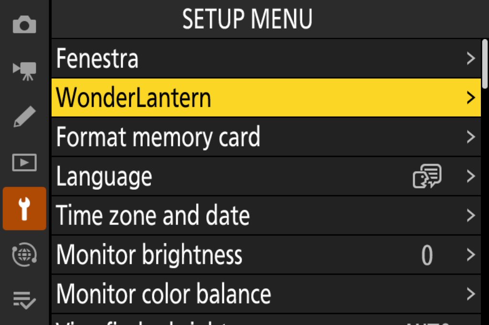 | 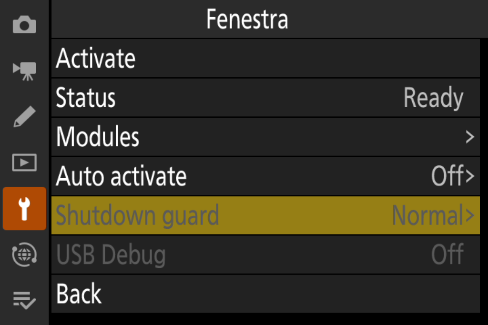 |
| **LCD Live View with `◎LIVE` Ready Badge** | **EVF Electronic Viewfinder (`Output 4`) with `◎LIVE`** |
| 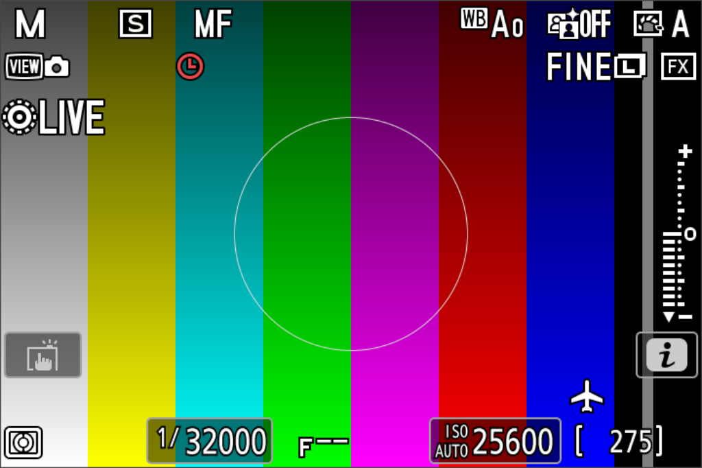 | 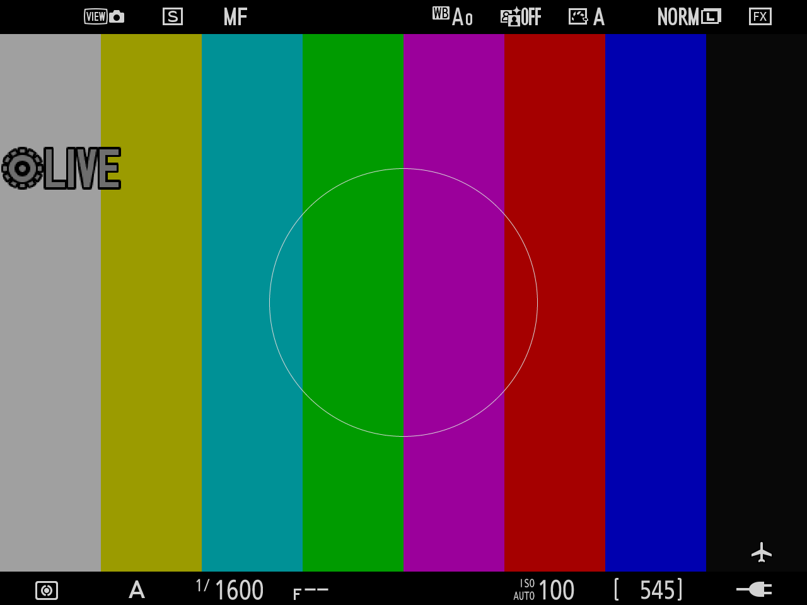 |
| **Photo Playback (`◎LIVE` Indicator)** | **Press `REC` → Native MOV Player (`00m03s`)** |
| 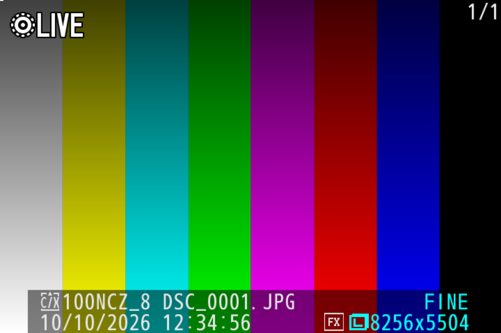 | 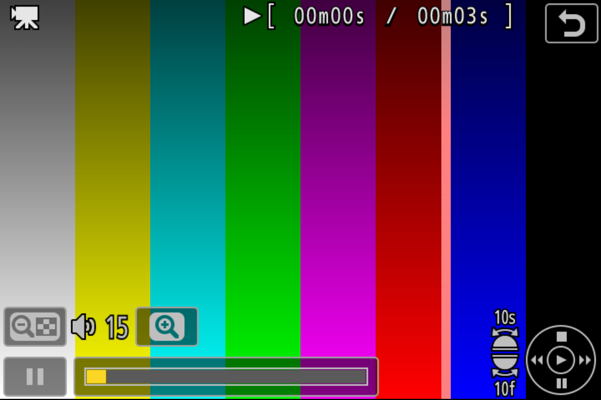 |
| **Portrait Video Standby & Recording HUD** | **Restored Video `Log settings` (`V62`)** |
|  | 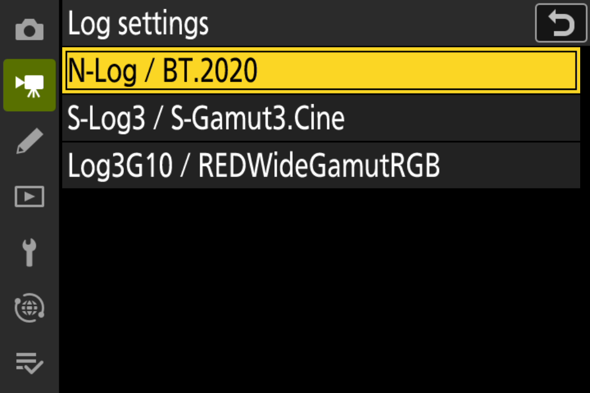 |

---

## Feature Summary

| Feature | Where It Lives | What It Does |
| :--- | :--- | :--- |
| **Fenestra Menu & Boot Guard** | `src/`, `host/build_z8_core.py` | Native `Setup → Fenestra` menu (`Activate`, `Auto activate`, `Shutdown guard`, `Modules`) that automatically disables loading if the previous session crashed or lost power mid-run. |
| **Loadable `.wlm` Modules & SDK** | `include/`, `examples/hello/`, `modules/demo/` | Build standalone `.wlm` apps in C without needing Nikon firmware or keys; place in `FENESTRA/` on the card and open via `Setup → WonderLantern`. |
| **Live Photo Capture & Audio** | `research/z8-live/` (`V62`) | Rolling Wave5 video (~1.5 s before and ~1.5 s after shutter) paired with still photos, synced ambient audio, and selectable Live Shutter Sound (`On` / `Off`). |
| **In-Camera Live Photo Playback** | `feat-onemov/` (`V54`–`V62`) | Displays a `◎LIVE` badge in single-photo playback (RAW-primary and cross-card JPEG aware); press **`REC`** to play the paired `.MOV` in Nikon's native player and automatically return to the photo. |
| **Portrait Video HUD & EVF Support** | `feat-v52/`, `feat-v53/` | Rotates and aligns vertical video status icons (`REC`, timecode, `2160 30p`, codec, exposure bar, histogram) to native vertical photo anchors across LCD and EVF. |
| **Video Log Menu Fix (`V62`)** | `feat-onemov/v62/` | Fixes dynamic UI text-ID collisions so `Log settings` (`N-Log / BT.2020`, `S-Log3 / S-Gamut3.Cine`, `Log3G10 / REDWideGamutRGB`) displays properly even after opening `Modules`. |
| **C32 / C64 Slots & Label Sizing** | `from-stock/`, `feat-c64label/` | Supports 32/64 custom Picture Control slots (`Slot card` boot switch in integrated builds) plus a standalone `c64label_patch.py` 28-pt label descriptor helper. |
| **Host `INFO` Debug Bridge** | `host/ptp_linux.py`, `linux/` | Hash-pinned static AArch64 Linux agent supporting a strict parameterless `INFO` query (arbitrary shell execution is disabled on Z8 C3.11). |

---

## Deployment & Build Guide

### 1. Prerequisites

- **Environment**: Linux or **Windows 11 WSL2 (`Ubuntu`)** is recommended for full firmware builds and companion [`z8-qemu`](https://github.com/YCX81/z8-qemu) emulation. (macOS and native Linux/Windows can also compile standalone `.wlm` SDK modules.)
- **Toolchains**:
  - Python `3.11+`
  - LLVM (`clang`, `ld.lld`, `llvm-objcopy`, `llvm-nm`) supporting `aarch64-none-elf`
  - `aarch64-linux-gnu-gcc` (with static linking support, used by `build_z8_core.py` to build the `INFO` agent)

```bash
git clone --branch z8-c311 https://github.com/YCX81/fenestra-z8.git
cd fenestra-z8

python3 -m venv .venv
source .venv/bin/activate
python -m pip install -r requirements.txt
# Optional: only needed if using USB/PTP host scripts
python -m pip install -r requirements-host.txt
```

---

### 2. Route A: Build the Core Emulation Image & `.wlm` SDK Modules

Use this route when developing `.wlm` modules or testing the base Fenestra core inside [`z8-qemu`](https://github.com/YCX81/z8-qemu).

#### Build `.wlm` Modules (No Firmware Required)

```bash
# Build the minimal menu action example -> build/hello-z8/hello.wlm
python host/build_sdk_module.py examples/hello/module.c \
  --id hello --target z8-c311 --output-dir build/hello-z8

# Build the OpenVG animated character-rain demo -> build/demo-z8/demo.wlm
python host/build_sdk_module.py modules/demo/sdk.c \
  --id demo --target z8-c311 --output-dir build/demo-z8
```

#### Build the Z8 Core Emulation `MAIN`

Supply your extracted `81,807,709`-byte stock Z8 C3.11 `MAIN` (`SHA-256: 2b43a31c9de838f84b12416de4348a7004e65be07f853ec56ec2b10f3a8e3853`):

```bash
python host/build_z8_core.py \
  --firmware /absolute/path/to/z8-c311-main.bin \
  --output-dir build/z8-core-local
```

> **Note:** `--output-dir` must not already exist. Pass `--agent-cc /path/to/aarch64-linux-gnu-gcc` if your cross-GCC has a custom name. The generated `z8-core.main` is **strictly for QEMU emulation**, not for flashing to a camera.

---

### 3. Route B: Reconstruct Integrated Firmware from Stock `Z_8_0311.bin`

To reproducibly build the integrated Live Photo + C64 + Portrait + NFP baseline (`v36`) directly from an unmodified official `Z_8_0311.bin` (`99,051,117` bytes, `SHA-256: d67413c2ede6b9ce8887175f20700bd9fbad2a973a4820968c45503d15d80d96`) without any private intermediate files:

1. Clone both `fenestra-z8` (`z8-c311`) and [`z8-qemu`](https://github.com/YCX81/z8-qemu) (`main`) in Linux / WSL.
2. Install **Clang 18** (`clang-18`, used for the historical core) and **Clang/LLVM 21** (`clang-21`, `ld.lld`, `llvm-nm`, `llvm-objcopy`, `llvm-objdump`, used for Live/Playback/bootguard), plus Python packages from `research/z8-live/from-stock/requirements.txt`.
3. Run the single-command builder:

```bash
python -m pip install -r research/z8-live/from-stock/requirements.txt

python -B research/z8-live/from-stock/build.py \
  --stock /absolute/path/to/Z_8_0311.bin \
  --qemu-root /absolute/path/to/z8-qemu \
  --output-dir /absolute/path/to/v36-rebuilt
```

- Pass `--core-clang`, `--live-clang`, and `--llvm-bin` if multiple LLVM versions are installed side-by-side; add `--main-only` to skip repacking the outer update container.
- The script verifies every intermediate and final SHA-256 against pinned values (`v36.main` and `Z_8_0406.bin`). See [research/z8-live/from-stock/README.md](research/z8-live/from-stock/README.md).
- Incremental source checkpoints from `V54` through **`V62`** (single-MOV native playback, RAW cross-card pairing, Log menu text fix, and Live shutter sound handoff) are documented in [RELEASE-v62.md](research/z8-live/build-tools/livediag/feat-onemov/RELEASE-v62.md).

---

### 4. Memory Card Deployment Layout

When using `.wlm` modules or running an integrated Live Photo build, the memory card uses the following directory layout:

```text
<Card Root>/
├── Z_8_0406.bin              # Update package (only placed at root during a camera firmware update)
├── FENESTRA/
│   ├── hello.wlm             # Active loadable module (.wlm)
│   ├── demo.wlm.disabled     # Disabled module (ignored on next boot)
│   └── live-z8.0 / live-z8.1 # Dual-copy Live Photo settings (managed by camera; do not edit as text)
├── DCIM/100NCZ_8/
│   ├── DSC_0001.NEF / .JPG   # Original still photo written by Nikon's native writer
│   └── LIV_0001.MOV          # Optional DCIM clip copy (when enabled on historical builds)
├── LIVE/100NCZ_8/
│   └── DSC_0001.MOV          # Paired Live Photo video+audio clip (~3s H.264/HEVC + audio)
└── LIVEDATA/100NCZ_8/
    └── DSC_0001.MAN / .LVP   # Pairing manifest (.MAN) & internal preview metadata
```

> **Updating between Live versions:** Only replace `Z_8_0406.bin` at the card root and follow the standard Nikon firmware update steps (full battery, stable card). **Keep your existing `FENESTRA/`, `DCIM/`, `LIVE/`, and `LIVEDATA/` folders intact** so saved settings and existing Live Photo pairings continue to work.

---

## Detailed Feature Usage

### 1. Fenestra Menu, Modules & Abnormal Shutdown Guard

| Abnormal Shutdown Protection | Running the `demo.wlm` OpenVG Module |
| :---: | :---: |
| 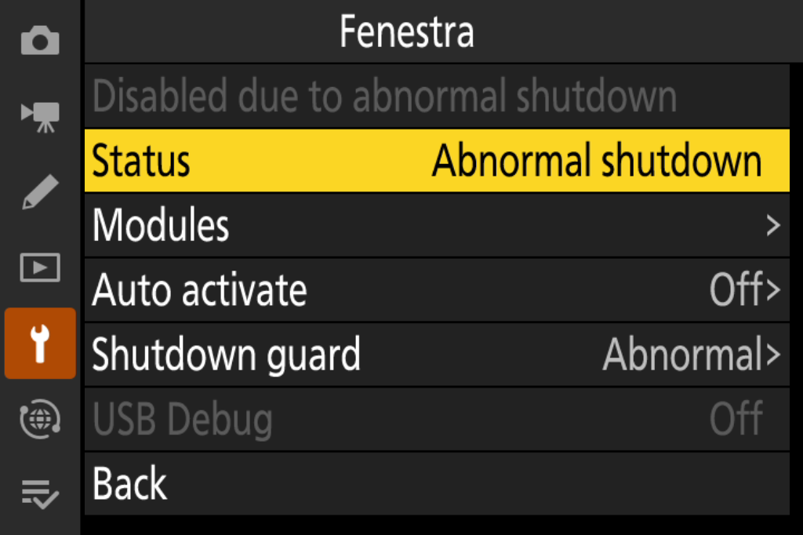 | 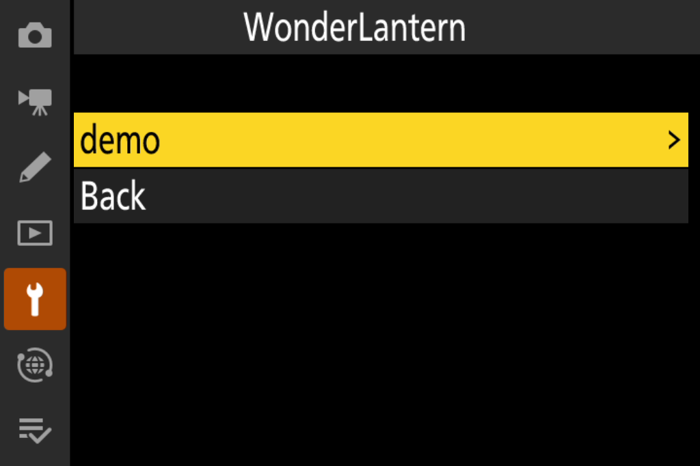 |

1. **Copy Modules**: Place `.wlm` files built with `--target z8-c311` into `FENESTRA/` on the card.
2. **Activate Fenestra**: Press `MENU` → go to the **Setup Menu (wrench icon)** → open **`Fenestra`** → press **`Activate`**. `Status` changes from `Ready` to `Active`.
   - *Tip*: On the Z8 menu tab bar, pressing `Right` once moves focus into the menu list; pressing `Right` or `OK` again opens the highlighted item.
3. **Manage Modules**: Open `Fenestra → Modules` to inspect discovered `.wlm` files and toggle them `On` / `Off` for the next boot (disabled files are renamed `.wlm.disabled`).
4. **Open Module UI**: Return to the Setup Menu and open **`WonderLantern`** to access custom pages registered by active modules (such as `Hello module` or `demo`).
5. **Recover from Abnormal Shutdown**: If the camera lost power or crashed while Fenestra was active, the boot flag triggers **`Disabled due to abnormal shutdown`** on the next boot to prevent boot loops. Verify camera stability first, then clear the abnormal flag in `Shutdown guard` before re-activating.

---

### 2. Shooting Live Photos (LCD, EVF & Shutter Sound)

| `Live Photo` Menu & Shutter Sound (`V62`) | `◎LIVE` Badge States (Ready / Busy Sweep / Playback) |
| :---: | :---: |
| 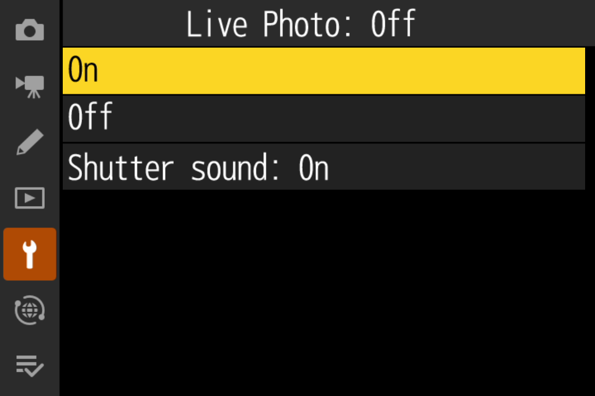 | 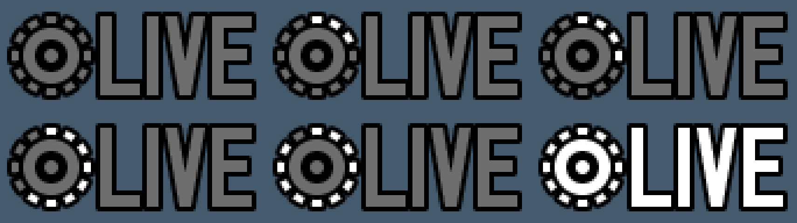 |

1. **Enable Live Photo**: In photo mode, open `Setup → Fenestra → Live Photo` and select **`On`**.
   - Menu status meanings:
     - `Off`: Disabled.
     - `Requested` / `Preparing`: Encoder is initializing—wait a moment before shooting.
     - `Ready`: Rolling capture is active; the **`◎LIVE`** badge appears on the shooting screen.
     - `Busy`: Finishing file pairing/saving for the shot just taken (the `◎LIVE` ring animates a sweep).
     - `card error` / `Unavailable`: Card write failure or video pipeline busy/unavailable.
2. **Configure Shutter Sound (`V62`)**: Inside `Live Photo`, toggle **`Shutter sound`** between **`On`** and **`Off`**.
   - `On` plays the camera's selected shutter tone and automatically hands the shared audio codec back to the microphone afterward.
   - `Off` mutes both the prepare and fire shutter sound stages so the Live clip records uninterrupted ambient audio.
   - **Camera Silent Mode always wins**: If Nikon's native Silent Photography mode is enabled, `Shutter sound: On` will **not** force the speaker to make noise.
3. **Take the Photo**: Once `◎LIVE` is visible (on LCD or EVF), shoot normally (JPEG, RAW, or dual-card RAW + JPEG). Wait for the `◎LIVE` busy sweep animation to finish saving.

---

### 3. Playing Back Live Photos (`REC` Button)

1. Press the **Playback (`▶`)** button to view your photos. Any still photo (`.NEF` or `.JPG`, including dual-card RAW + JPEG pairs) with a valid paired clip displays a crisp white **`◎LIVE`** badge in the top-left corner.
   - *Note*: If the `.MAN` manifest was still flushing when first viewed, `V61`/`V62` automatically retries pairing with rate limiting.
2. Press the red **`REC` (movie record)** button while viewing that photo:
   - In `V54`–`V62`, the camera opens the paired `.MOV` clip directly in **Nikon's native video player** with full resolution, audio playback, volume indicator, and progress bar.
   - When the ~3-second clip finishes—or if you press `REC` / back early—the screen cleanly returns to the exact still photo you were viewing (including returning to the original RAW file).
3. Non-Live photos ignore `REC` or keep stock playback key behavior.

---

### 4. Portrait Video HUD, Video Log Menu & C64 Slots

| Portrait Video Standby (`90°` Upright) | `Slot card` (`C32` / `C64` Next-Boot Switch) |
| :---: | :---: |
| 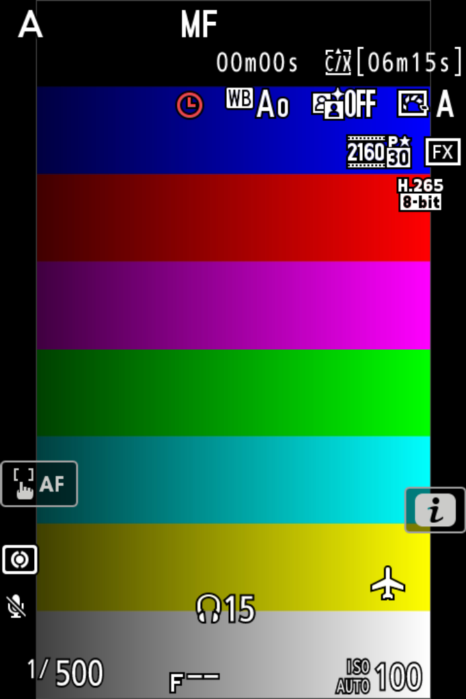 | 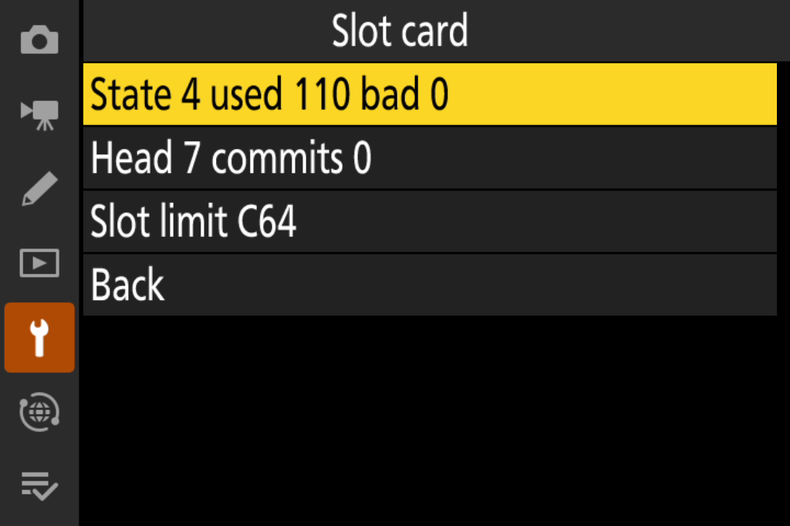 |

- **Portrait Video Layout**: Rotating the camera vertically in video mode automatically rearranges top/bottom status rows (`REC`, timecode, `2160 30p`, `FX`, codec, shutter, aperture, ISO) and keeps the live histogram inside the vertical frame instead of clipping off-screen.
- **Video `Log settings` (`V62`)**: Open `VIDEO RECORDING MENU → Log settings` to select `N-Log / BT.2020`, `S-Log3 / S-Gamut3.Cine`, or `Log3G10 / REDWideGamutRGB` (available when a compatible 10-bit/RAW video format is selected). `V62` ensures these labels remain intact even after opening and exiting `Fenestra → Modules`.
- **C32 / C64 Picture Control Slots & Label Patch**:
  - In integrated builds that include `Slot card`, choose `C32` or `C64` under `Fenestra → Slot card` and reboot to switch active slot capacity.
  - For offline development on an already-expanded C64 `MAIN`, `c64label_patch.py` adjusts the 275 shared slot descriptors to 28-pt font size:
    ```bash
    python research/z8-live/build-tools/livediag/feat-c64label/c64label_patch.py \
      /path/to/input.main /path/to/output-c64label.main \
      --reference /path/to/bg34.main \
      --json /path/to/output-c64label.changed.json
    ```
    *(Note: `c64label_patch.py` only edits label font size on an existing C64 layout; it does not create C64 slots on a stock `MAIN`.)*

---

### 5. Developing Custom Modules & Host `INFO` Debugging

- **Custom Stack / SIMD Options**: For larger `.wlm` modules (up to `1 MiB` package / `4 MiB` loaded image), request a `v3` header with custom stacks or SIMD context preservation:
  ```bash
  python host/build_sdk_module.py examples/hello/module.c \
    --id hello --target z8-c311 \
    --native-stack-bytes 131072 --user-stack-bytes 131072 --simd \
    --output-dir build/hello-v3-z8
  ```
  See [docs/module-development.md](docs/module-development.md) and [docs/api-reference.md](docs/api-reference.md).
- **Host `INFO` Bridge**: On Z8 C3.11, `FENESTRA_PTP_PROFILE=z8-c311` only permits the parameterless `info` query against the SHA-256-pinned `fenestra-agent-z8-info` binary (arbitrary `exec`/shell commands are rejected by design). See [docs/debugging.md](docs/debugging.md).

---

## Precautions & Limitations

1. **Do not confuse `.main` with `.bin`**: Raw `.main` outputs (`z8-core.main`, `v36.main`) are unwrapped application images for QEMU or intermediate linking—**never** copy a `.main` file onto a card expecting a camera update.
2. **Wait for Live saving between rapid shots**: If you fire another still while the previous Live Photo is still in `Busy` saving state, the new photo saves normally as a still, **without** a paired Live video clip.
3. **Brief mic mute when `Shutter sound: On`**: Because the Z8 speaker and microphone share audio codec hardware, playing the shutter sound inserts a brief (~0.25 s) silent gap near the shutter moment in the Live audio track. Set `Shutter sound: Off` if you want continuous ambient audio.
4. **Exporting Live Photos to PC/Phone**: Copy both the still photo (`DCIM/.../DSC_xxxx.JPG` or `.NEF`) **and** its paired clip (`LIVE/.../DSC_xxxx.MOV`). Files inside `LIVEDATA/` (`.MAN` / `.LVP`) are camera-internal pairing metadata, not playable standalone videos, and macOS/iOS Photos will not automatically merge camera-written `DSC_xxxx.JPG` + `.MOV` into an Apple Live Photo without desktop pairing tools.
5. **Module unloading requires a reboot**: Disabling or renaming a `.wlm` to `.wlm.disabled` prevents it from loading on the **next** boot; already-loaded modules stay resident until you power-cycle the camera. Never enable two copies of the same module ID at once.
6. **Verify source integrity before publishing**: Placeholder paths like `/path/to/Nikon` or `/path/to/user` in archived research scripts must be adapted to your local environment. Never commit Nikon firmware, keys, or personal media; run `python -B verify_source.py` to check the source inventory.

---

## Documentation & License

- **Core & SDK Docs**: [Getting Started](docs/getting-started.md) · [Architecture](docs/architecture.md) · [SDK API Reference](docs/api-reference.md) · [Module Development](docs/module-development.md) · [Module Format](docs/module-format.md) · [Debugging & PTP](docs/debugging.md) · [Porting Guide](docs/porting.md)
- **Z8 Live Archive**: [Live Source Map](research/z8-live/README.md) · [Stock-to-v36 Reconstruction](research/z8-live/from-stock/README.md) · [V62 Release Notes](research/z8-live/build-tools/livediag/feat-onemov/RELEASE-v62.md) · [Core Port Notes](port-z8/PORT-STATUS.md)
- **License**: [CC BY-NC-SA 4.0](LICENSE) with the [Commercial Photography Exception](EXCEPTIONS.md) and [Z8 Adaptation Terms](LICENSE-Z8.md). Using the software for paid photography and filmmaking is explicitly permitted; selling covered software, modules, or paid flashing services is **not** permitted. Third-party components (such as bundled public [NikonFirmwarePatch](https://github.com/XinmiaoZhao/NikonFirmwarePatch) toolkits in `from-stock` and `minih264e.h`) retain their respective licenses.
