# Fenestra for Nikon Z8 (`C3.11`)

[English](README.md) | **简体中文**

`fenestra-z8` 是面向 **Nikon Z8（原厂固件 C3.11）** 移植与扩展的 [WonderLantern/Fenestra](https://github.com/WonderLantern/Fenestra) 仓库（默认分支：`z8-c311`）。仓库内包含两条相互独立但彼此配合的源码路线，使用前请先区分清楚：

1. **基础核心框架与 `.wlm` 模块开发 SDK（根目录 `src/`、`host/`、`examples/`、`modules/`）**
   在 Z8 原厂设定菜单中注入 **Fenestra** 与 **WonderLantern** 入口，提供异常关机防变砖保护、存储卡 `.wlm` 模块动态加载、C 语言 UI/OpenVG 绘图 SDK，以及受限的 `INFO` 主机调试桥。
2. **Live Photo（实况照片）+ C64 + 竖屏集成固件源码（`research/z8-live/`，更新至 `V62`）**
   完整归档 Z8 增强功能开发链：包括**机内 Live Photo 实况照片**（快门前后循环录影 + 同步环境录音 + 实况快门声开关）、**回放界面按 `REC` 调用原厂播放器直接播放配对短片**（支持 RAW 优先与双卡 RAW+JPEG 跨卡配对）、**LCD 与 EVF 取景器 `◎LIVE` 状态徽标**、**竖屏视频界面与直方图重排**、**64 个自定义优化校准槽位（`C64`）**，以及 **`V62` 视频 Log 菜单文字修复**。

> [!IMPORTANT]
> **编译与上机前必读**
> - **本仓库不分发任何预编译固件包或密钥**，你必须自行准备官方 Nikon Z8 `C3.11` 原厂固件（`Z_8_0311.bin` 或提取出的 `MAIN`）。
> - **分清两种构建产物，切勿混用：**
>   - 根目录 `host/build_z8_core.py` 生成的是**仅供 [`z8-qemu`](https://github.com/YCX81/z8-qemu) 模拟器加载的裸 `MAIN` 镜像**，**不是**相机升级文件；上游给 ZR/Z9 用的 `fenestra.py make-patch` 也**不能**用于 Z8。
>   - `research/z8-live/from-stock/build.py` 支持仅凭一份官方原厂 `Z_8_0311.bin` 一键重现 `v36.main` 及完整升级包 `Z_8_0406.bin`；后续演进至 **`V62`** 的源码与补丁链保存在 `research/z8-live/build-tools/livediag/feat-onemov/`。

---

## 界面与功能预览

| 设定菜单入口（`Fenestra` 与 `WonderLantern`） | Fenestra 运行控制菜单 |
| :---: | :---: |
| 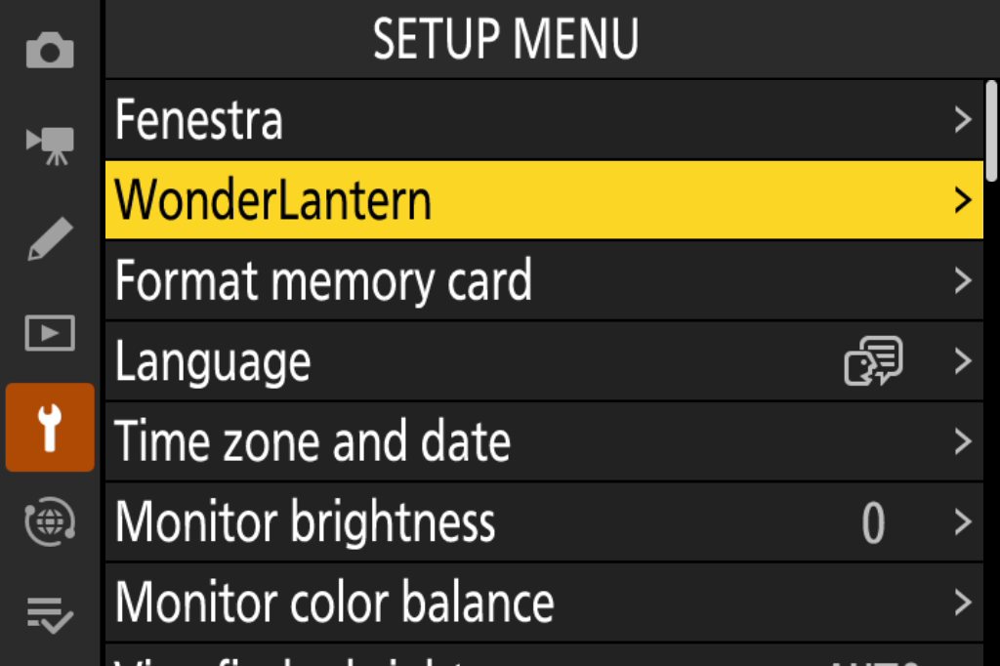 | 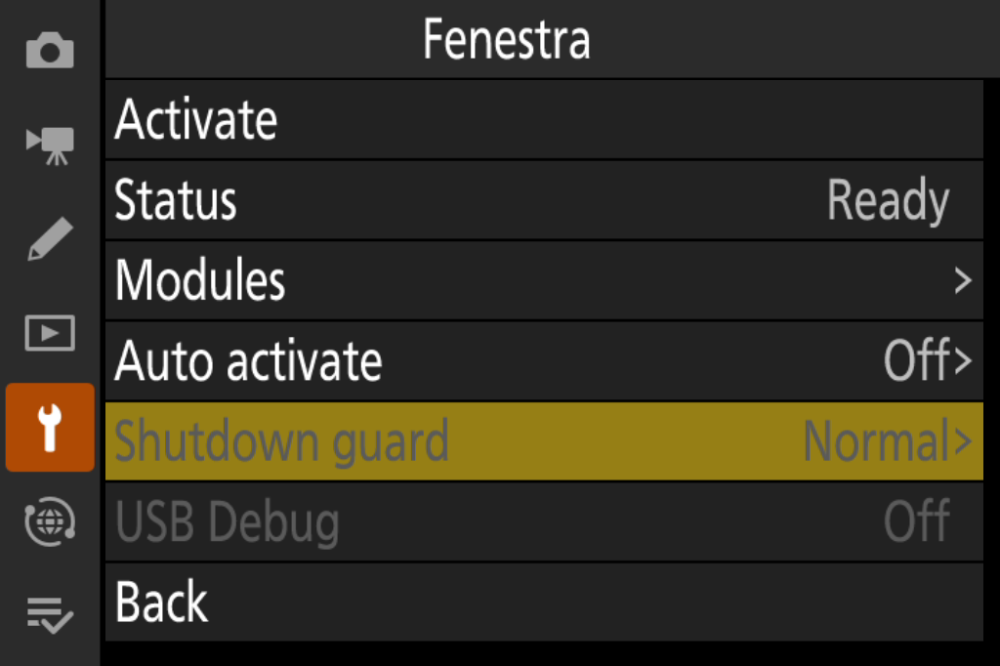 |
| **LCD 实时取景（左上角 `◎LIVE` 就绪徽标）** | **EVF 电子取景器（`Output 4` 含 `◎LIVE`）** |
| 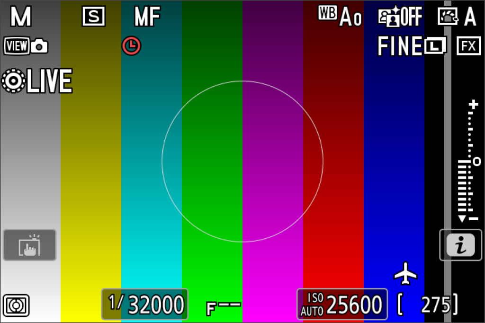 | 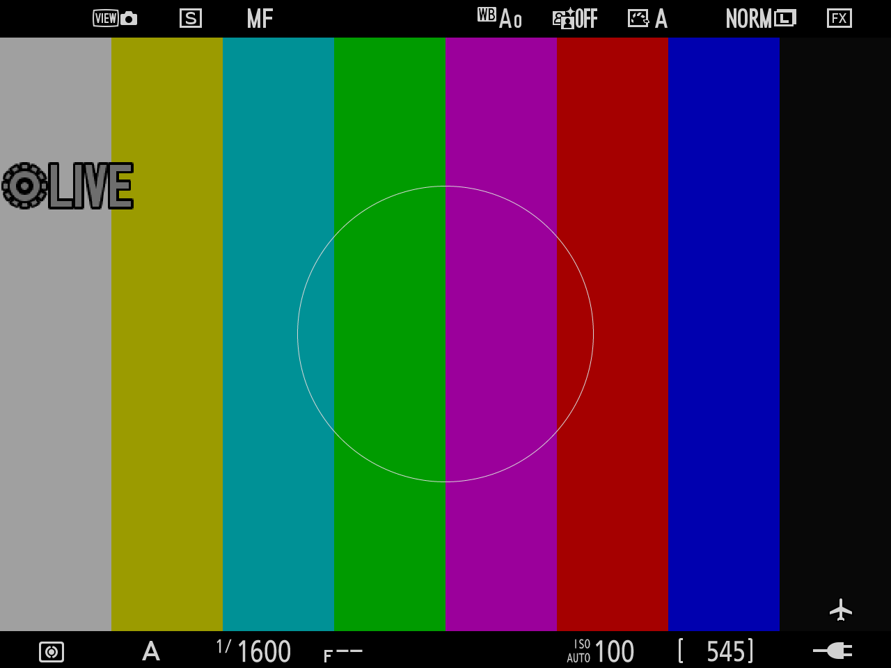 |
| **单张照片回放（显示 `◎LIVE` 标志）** | **回放中按 `REC` 键 → 原厂播放器回放短片** |
| 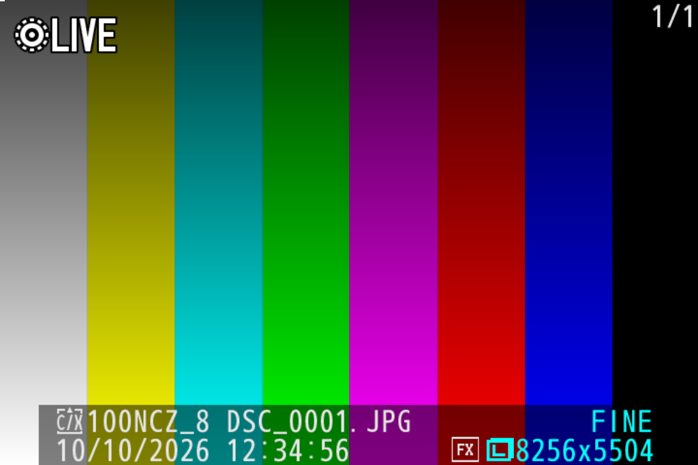 | 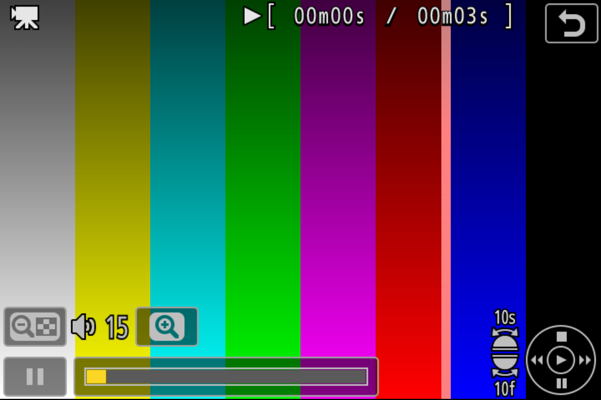 |
| **竖屏视频待机与录制界面（对齐竖拍布局）** | **`V62` 修复后的视频 `Log settings` 菜单** |
|  | 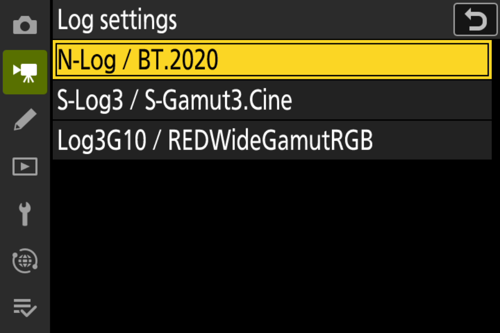 |

---

## 功能总览

| 功能模块 | 所在位置 | 功能说明 |
| :--- | :--- | :--- |
| **Fenestra 菜单与异常关机保护** | `src/`、`host/build_z8_core.py` | 在 `设定菜单 → Fenestra` 提供激活（`Activate`）、开机自启（`Auto activate`）、关机保护（`Shutdown guard`）与模块开关；上次死机或断电会自动拦截加载，防止循环卡死。 |
| **`.wlm` 扩展模块与开发 SDK** | `include/`、`examples/hello/`、`modules/demo/` | 无需原厂固件或密钥即可用 C 语言编写 `.wlm` 插件，拷入存储卡 `FENESTRA/` 目录后在 `WonderLantern` 中打开运行。 |
| **Live Photo 实况拍照与录音** | `research/z8-live/`（至 `V62`） | 拍照时自动保留快门前后各约 1.5 秒的 Wave5 视频与同步环境音轨，支持单独开关实况快门声（`Shutter sound: On / Off`）。 |
| **机内实况回放（支持双卡 RAW/JPEG）** | `feat-onemov/`（`V54`–`V62`） | 单张回放自动识别配对照片并显示 `◎LIVE`（支持 RAW 优先与双卡分存 JPEG 配对）；按红色 **`REC`** 键直接用尼康原厂播放器有声回放短片，播完自动退回原照片。 |
| **竖屏视频界面重排与 EVF 适配** | `feat-v52/`、`feat-v53/` | 竖拍视频时，`REC`、时间码、`2160 30p`、编码图标、底部曝光栏与实时直方图自动对齐竖屏拍照坐标，兼顾 LCD 与 EVF 显示。 |
| **视频 Log 菜单文字修复（`V62`）** | `feat-onemov/v62/` | 解决动态菜单文字编号冲突，确保 `Log settings`（`N-Log / BT.2020`、`S-Log3 / S-Gamut3.Cine`、`Log3G10 / REDWideGamutRGB`）在进出 `Modules` 后依然正常显示。 |
| **C32 / C64 槽位扩容与字号调整** | `from-stock/`、`feat-c64label/` | 集成版支持在 `Slot card` 切换 32/64 个自定义优化校准槽位；另附 `c64label_patch.py` 独立字号调整脚本。 |
| **Linux `INFO` 主机调试桥** | `host/ptp_linux.py`、`linux/` | 绑定 SHA-256 校验的静态 AArch64 Linux agent，仅开放安全的无参数 `INFO` 状态查询（Z8 C3.11 默认禁用任意 shell 命令执行）。 |

---

## 部署与编译方式

### 1. 基础环境准备

- **推荐系统**：完整固件编译与配套 [`z8-qemu`](https://github.com/YCX81/z8-qemu) 整机仿真建议使用 **Linux** 或 **Windows 11 WSL2（`Ubuntu`）**；若只开发编译 `.wlm` 模块，macOS / Linux / Windows 均可直接运行。
- **编译工具链**：
  - Python `3.11+`
  - LLVM 工具链（`clang`、`ld.lld`、`llvm-objcopy`、`llvm-nm`，需支持 `aarch64-none-elf` 目标）
  - `aarch64-linux-gnu-gcc`（需支持 `-static` 静态链接，供 `build_z8_core.py` 编译 `INFO` agent）

```bash
git clone --branch z8-c311 https://github.com/YCX81/fenestra-z8.git
cd fenestra-z8

python3 -m venv .venv
source .venv/bin/activate
python -m pip install -r requirements.txt
# 可选：仅在使用 USB/PTP 主机连接脚本时需要
python -m pip install -r requirements-host.txt
```

---

### 2. 部署方式一：编译 `.wlm` 扩展模块与 QEMU 核心镜像

适合用 SDK 开发自定义模块，或在 [`z8-qemu`](https://github.com/YCX81/z8-qemu) 模拟器中测试基础菜单与插件。

#### 编译 `.wlm` 模块（不需要原厂固件）

```bash
# 编译最简菜单示例 -> 生成 build/hello-z8/hello.wlm
python host/build_sdk_module.py examples/hello/module.c \
  --id hello --target z8-c311 --output-dir build/hello-z8

# 编译 OpenVG 字符雨动画示例 -> 生成 build/demo-z8/demo.wlm
python host/build_sdk_module.py modules/demo/sdk.c \
  --id demo --target z8-c311 --output-dir build/demo-z8
```

#### 编译 Z8 核心仿真 `MAIN`

准备好从官方 C3.11 升级包提取出的 `81,807,709` 字节原厂 `MAIN`（`SHA-256: 2b43a31c9de838f84b12416de4348a7004e65be07f853ec56ec2b10f3a8e3853`）：

```bash
python host/build_z8_core.py \
  --firmware /absolute/path/to/z8-c311-main.bin \
  --output-dir build/z8-core-local
```

> **提示**：`--output-dir` 必须是尚未存在的新目录；若交叉编译器名字不同，可通过 `--agent-cc` 指定。生成的 `z8-core.main` **只能放进 QEMU 仿真运行，不能用于真机升级**。

---

### 3. 部署方式二：从官方原厂 `Z_8_0311.bin` 一键重建集成固件（`from-stock`）

如果你想从零构建包含 Live Photo + C64 + 竖屏布局 + NFP 视频增强的集成固件基线（`v36`），无需任何私有中间文件，只需准备一份官方未修改的 `Z_8_0311.bin`（`99,051,117` 字节，`SHA-256: d67413c2ede6b9ce8887175f20700bd9fbad2a973a4820968c45503d15d80d96`）：

1. 在 Linux / WSL2 中同时克隆本仓库（`z8-c311` 分支）和 [`z8-qemu`](https://github.com/YCX81/z8-qemu)（`main` 分支）。
2. 安装 **Clang 18**（编译核心底座）与 **Clang / LLVM 21**（`clang-21`、`ld.lld`、`llvm-nm`、`llvm-objcopy`、`llvm-objdump`，编译 Live/回放/bootguard），并安装 `research/z8-live/from-stock/requirements.txt`。
3. 执行一条命令完成构建与封装校验：

```bash
python -m pip install -r research/z8-live/from-stock/requirements.txt

python -B research/z8-live/from-stock/build.py \
  --stock /absolute/path/to/Z_8_0311.bin \
  --qemu-root /absolute/path/to/z8-qemu \
  --output-dir /absolute/path/to/v36-rebuilt
```

- 多版本编译器并存时可通过 `--core-clang`、`--live-clang`、`--llvm-bin` 显式指定路径；如果只需要 `MAIN` 供 QEMU 测试可加 `--main-only`。
- 脚本会自动利用仓库内置的公开 NFP 工具包完成编译、链接、CRC16 与外层封装，并逐阶段校验 `v36.main` 与 `Z_8_0406.bin` 的固定 SHA-256，详见 [from-stock 说明](research/z8-live/from-stock/README.md)。
- 后续演进至 **`V62`**（单 MOV 原厂播放器回放、RAW 跨卡配对、Log 菜单文字修复与快门声交接修复）的源码与 WSL 实验室构建说明见 [RELEASE-v62.md](research/z8-live/build-tools/livediag/feat-onemov/RELEASE-v62.md)。

---

### 4. 存储卡目录结构与升级部署说明

相机存储卡（CFexpress 或 SD）上的相关目录用途如下：

```text
<存储卡根目录>/
├── Z_8_0406.bin              # 固件升级包（仅在执行相机固件升级时放在根目录）
├── FENESTRA/
│   ├── hello.wlm             # 已启用的扩展模块 (.wlm)
│   ├── demo.wlm.disabled     # 已禁用的扩展模块（下次开机生效）
│   └── live-z8.0 / live-z8.1 # Live 开关与配置双备份文件（机内自动维护，请勿当普通文本手工编辑）
├── DCIM/100NCZ_8/
│   ├── DSC_0001.NEF / .JPG   # 原厂写入的静态照片（不会被篡改）
│   └── LIV_0001.MOV          # 早期版本可选开启的 DCIM 短片副本
├── LIVE/100NCZ_8/
│   └── DSC_0001.MOV          # 与照片配对的实况有声短片（约 3 秒）
└── LIVEDATA/100NCZ_8/
    └── DSC_0001.MAN / .LVP   # 机内配对清单 (.MAN) 与预览索引数据
```

> **版本升级方法（如更新至 `V62`）**：确保电池电量充足，**只替换存储卡根目录下的 `Z_8_0406.bin`**，然后在相机“设定菜单 → 固件版本”按常规升级流程操作即可。**请保留卡上原有的 `FENESTRA/`、`DCIM/`、`LIVE/` 和 `LIVEDATA/` 文件夹**，无需格式化或覆盖已有配置，旧实况照片的配对与回放会继续保留。内部版本号统一显示为 `04.06.p0`，具体版本以构建目录和 SHA-256 区分。

---

## 各功能详细使用说明

### 1. Fenestra 菜单、模块加载与异常关机保护

| 异常关机自动拦截（`Abnormal shutdown`） | 在 `WonderLantern` 中运行 `demo.wlm` 字符雨 |
| :---: | :---: |
| 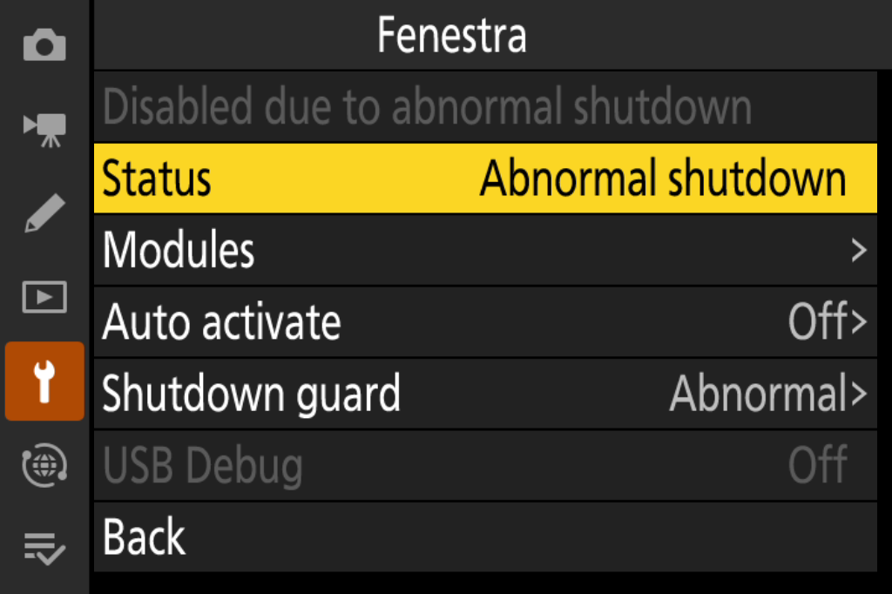 | 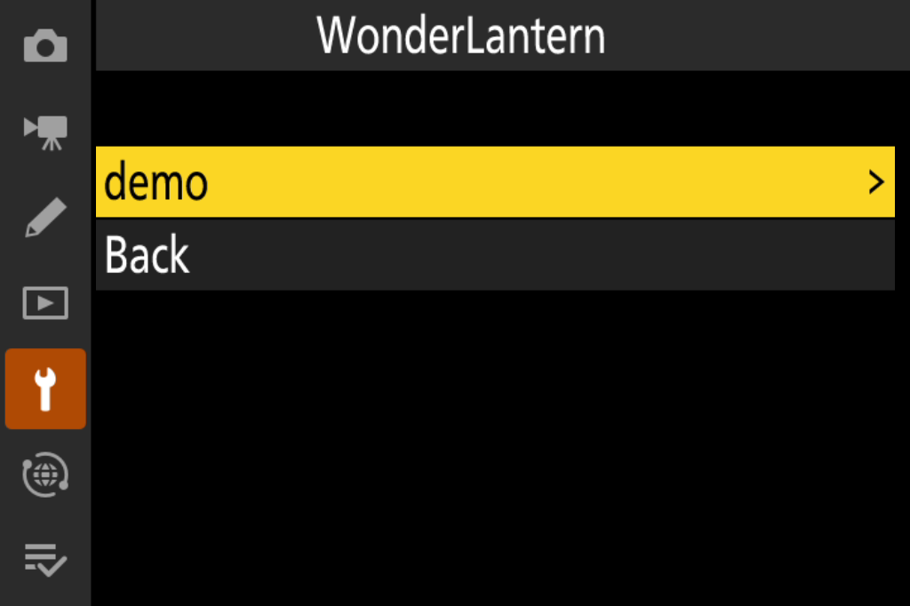 |

1. **放入模块**：将针对 `z8-c311` 编译的 `.wlm` 文件拷入存储卡根目录的 `FENESTRA/` 文件夹。
2. **激活运行**：按机身 `MENU` 键 → 切到左侧**扳手图标（设定菜单）** → 进入 **`Fenestra`** → 点击 **`Activate`**，`Status` 由 `Ready` 变为 `Active`。
   - *按键小贴士*：焦点在左侧图标栏时，按第一下方向键 `右` 是进入列表，再按一次 `右` 或 `OK` 才是打开子页面。
3. **管理模块**：进入 `Fenestra → Modules` 可查看已识别的模块，切换 `On` / `Off`（禁用后会改名为 `.wlm.disabled`，重启后不再加载）。
4. **打开模块界面**：返回设定菜单打开 **`WonderLantern`**，即可看到并进入模块注册的功能页（如 `Hello module` 或 `demo`）。
5. **异常关机恢复**：如果相机在激活期间曾意外断电或崩溃，下次开机会显示 **`Disabled due to abnormal shutdown`** 并拒绝自动激活，避免坏模块导致开机死循环。确认排障后，进入 `Shutdown guard` 清除异常标志（`Clear abnormal flag`），即可重新激活。

---

### 2. 拍摄 Live Photo 实况照片（LCD / EVF / 快门声设置）

| `Live Photo` 菜单与快门声开关（`V62`） | `◎LIVE` 徽标状态（就绪 / 保存扫光动画 / 回放高亮） |
| :---: | :---: |
| 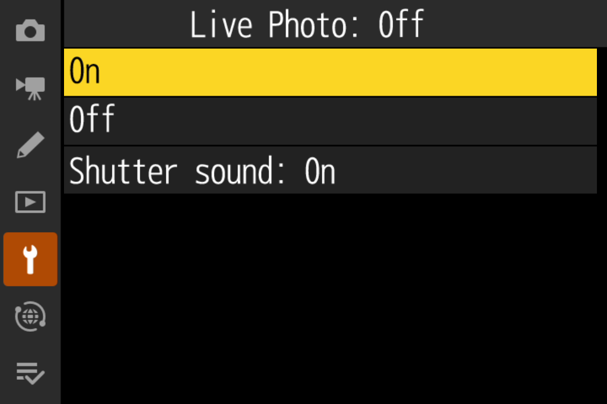 |  |

1. **开启实况拍照**：在拍照模式下，进入 `设定菜单 → Fenestra → Live Photo`，选择 **`On`**。
   - 状态提示含义：
     - `Off`：已关闭。
     - `Requested` / `Preparing`：正在初始化编码器，请稍候片刻。
     - `Ready`：已就绪，取景画面左侧会出现 **`◎LIVE`** 徽标，此时拍照才会生成实况短片。
     - `Busy`：刚拍完正在后台封装保存短片，取景画面上的 `◎LIVE` 外圈会旋转扫光。
     - `card error` / `Unavailable`：存储卡写入异常或编码通道正被其他模式占用。
2. **设置实况快门声（`V62`）**：在 `Live Photo` 子菜单中可将 **`Shutter sound`** 设为 **`On`** 或 **`Off`**：
   - 设为 `On`：按下快门时正常播放机身设定的快门音效，发声结束后自动恢复麦克风继续录音。
   - 设为 `Off`：同时静默快门准备与释放两个发声阶段，让实况短片录下不间断的环境声。
   - **原厂静音模式依然优先**：如果你在尼康机身菜单开启了“静音拍摄（Silent mode）”，即便此处设为 `On` 也不会强制出声。
3. **正常按快门拍摄**：看到 LCD 或 EVF 取景器上显示 `◎LIVE` 后正常构图拍照即可（单张 JPEG、RAW，或双卡 RAW + JPEG 分存均支持），拍完等待 `◎LIVE` 扫光动画结束即保存完毕。

---

### 3. 在相机内回放 Live Photo（按 `REC` 键播放）

1. 按机身 **`▶`（回放键）** 查看单张照片。只要该照片（无论是 `.NEF` 还是 `.JPG`，含双卡分存场景）存在配对的实况数据，屏幕左上角就会亮起醒目的白色 **`◎LIVE`** 标志。
   - 若刚拍完立即按回放、配对清单尚未落盘，`V61`/`V62` 会自动按限频重试识别。
2. 在显示 `◎LIVE` 的照片回放页，直接按机身顶部的红色 **`REC`（录影键）**：
   - `V54`–`V62` 会直接调起**尼康原厂视频播放器**播放配对的 `.MOV` 短片（带环境音轨、音量指示和底部进度条）。
   - 短片播完（约 3 秒），或者播放中途再次按 `REC` / 返回键，界面会**自动退回刚才那张原照片**（包括精确退回原 RAW 照片）。
3. 查看普通非实况照片时按 `REC` 键不会误触发，保持原厂按键逻辑不变。

---

### 4. 竖屏视频界面、视频 Log 设定与 C64 优化校准槽位

| 竖屏视频待机界面（旋转竖看效果） | `Slot card` 切换 `C32` / `C64` 容量（下次开机生效） |
| :---: | :---: |
| 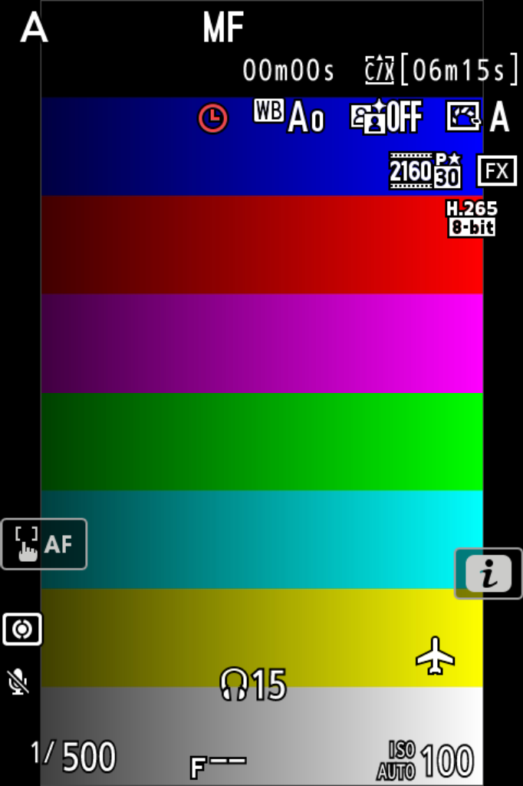 | 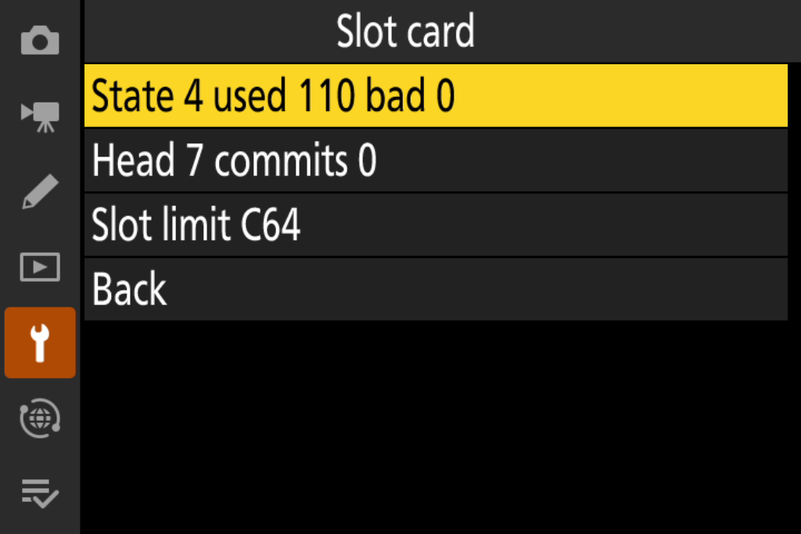 |

- **竖屏视频界面与直方图对齐**：竖握机身进入视频模式时，顶部与底部的拍摄参数（`REC`、录制时长、`2160 30p`、`FX`、编码图标、快门/光圈/ISO）及实时直方图会自动按竖屏拍照布局排列，不再横向溢出画面。
- **视频 `Log settings` 菜单（`V62`）**：切到 10-bit 或 RAW 视频格式后，在 `视频拍摄菜单 → Log settings` 中可正常查看和选择 `N-Log / BT.2020`、`S-Log3 / S-Gamut3.Cine`、`Log3G10 / REDWideGamutRGB`；`V62` 修复了打开 `Modules` 页面后再回到视频菜单时这几行文字变空白的问题。
- **C32 / C64 优化校准槽位与标签字号补丁**：
  - 在集成有 `Slot card` 的版本中，可在 `Fenestra → Slot card` 选择 `C32` 或 `C64`，重启相机后即可在“设定优化校准”中使用最多 64 个照片/视频自定义槽位。
  - 若你在做离线固件定制、想把已有 C64 `MAIN` 的 `C10`–`C64` 标签统一调为 28 号字，可使用独立脚本：
    ```bash
    python research/z8-live/build-tools/livediag/feat-c64label/c64label_patch.py \
      /path/to/input.main /path/to/output-c64label.main \
      --reference /path/to/bg34.main \
      --json /path/to/output-c64label.changed.json
    ```
    *（注意：该脚本只修改已扩容 `MAIN` 上的 275 个共享样式描述符，本身不会给原厂固件扩容出 C64 槽位。）*

---

### 5. 开发自定义 `.wlm` 模块与主机 `INFO` 调试

- **大内存栈与 SIMD 支持**：单个 `.wlm` 包最大支持 `1 MiB`（加载后最高 `4 MiB`）。如果模块需要更大的原生栈/用户栈或完整 NEON/SIMD 寄存器保护，可生成 `v3` 包：
  ```bash
  python host/build_sdk_module.py examples/hello/module.c \
    --id hello --target z8-c311 \
    --native-stack-bytes 131072 --user-stack-bytes 131072 --simd \
    --output-dir build/hello-v3-z8
  ```
  完整状态机与服务接口请参考 [模块开发指南](docs/module-development.md) 与 [SDK API 参考](docs/api-reference.md)。
- **主机 `INFO` 调试桥**：在 Z8 C3.11 配置（`FENESTRA_PTP_PROFILE=z8-c311`）下，`host/ptp_linux.py` 仅允许加载经 SHA-256 白名单校验的 `fenestra-agent-z8-info` 执行无参数 `info` 查询，主动拒绝任意命令行执行。详见 [调试说明](docs/debugging.md)。

---

## 注意事项与常见坑

1. **严禁把裸 `.main` 当升级包拷卡刷机**：`z8-core.main`、`v36.main` 等 `.main` 文件是未封装的内存镜像，只有完整校验封装后的容器（如 `Z_8_0406.bin`）才是升级包格式。
2. **保存忙碌期间连拍不会补录短片**：上一张实况照片还在 `Busy` 扫光写卡时如果立刻再拍一张，新照片本身会正常保存，但**不会**生成对应的实况短片；想每张都带实况请等扫光结束后再按快门。
3. **开启实况快门声会有约 0.25 秒短暂静音**：由于机身扬声器与麦克风共用音频硬件通道，`Shutter sound: On` 播放快门音交接期间，实况短片在快门瞬间会有约 0.25 秒静音；若追求全程无断音的环境声，把实况快门声设为 `Off` 即可。
4. **导出实况素材时保留配对文件**：拷到电脑备份时请同时拷走 `DCIM/` 下的原图（`.NEF`/`.JPG`）和 `LIVE/` 下同名的 `.MOV` 短片。`LIVEDATA/` 里的 `.MAN`/`.LVP` 是机内专用配对索引，不能当普通视频播放；直接把机内 JPG+MOV 拖进苹果相册也不会自动合并为 iPhone 实况图（需借助桌面端 Live Photo 写入工具添加 ContentIdentifier 元数据）。
5. **停用 `.wlm` 模块需重启生效**：不支持运行时热卸载已驻留回调的模块；在 `Modules` 里设为 `Off` 或改名 `.wlm.disabled` 后，请重启相机使其生效。切勿在卡上同时启用两个同 ID 的模块副本。
6. **切勿提交固件与私人路径**：归档脚本中的 `/path/to/Nikon`、`/path/to/user` 为脱敏占位路径，复现时需改为你本机的实际路径。提交代码前请运行 `python -B verify_source.py` 校验发布清单，确保未混入原厂固件、密钥或私人照片。

---

## 文档索引与许可协议

- **核心与 SDK 文档**：[快速上手](docs/getting-started.md) · [系统架构](docs/architecture.md) · [SDK API 手册](docs/api-reference.md) · [模块开发](docs/module-development.md) · [模块包格式](docs/module-format.md) · [USB/PTP 调试](docs/debugging.md) · [平台移植说明](docs/porting.md)
- **Z8 Live 专题归档**：[Live 源码目录导览](research/z8-live/README.md) · [从原厂固件重建 v36](research/z8-live/from-stock/README.md) · [V62 版本说明](research/z8-live/build-tools/livediag/feat-onemov/RELEASE-v62.md) · [核心移植记录](port-z8/PORT-STATUS.md)
- **许可证**：采用 [CC BY-NC-SA 4.0](LICENSE)，并附带 [商业摄影例外许可](EXCEPTIONS.md) 与 [Z8 移植适用范围说明](LICENSE-Z8.md)——**允许使用本软件从事收费商业摄影、婚礼跟拍及影视制作**，但**禁止出售本软件/衍生模块或提供有偿代刷机服务**。仓库内引用的第三方公开组件（如 `from-stock` 随附的公开 [NikonFirmwarePatch](https://github.com/XinmiaoZhao/NikonFirmwarePatch) 工具包与 `minih264e.h`）保留其各自原有的开源许可。
