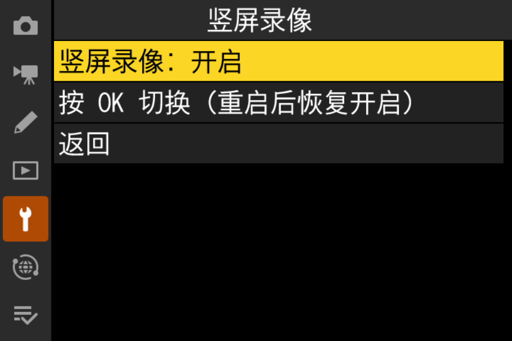

# Fenestra for Nikon Z8 (`C3.11`)

[English](README.md) | **简体中文** · [V71.7-r7 详细功能与全菜单设置手册（中文）](docs/features-and-usage.zh-CN.md) | [Detailed V71.7-r7 Feature & Menu Reference (EN)](docs/features-and-usage.md)

`fenestra-z8` 是面向 **Nikon Z8（原厂固件 C3.11）** 移植与扩展的 [WonderLantern/Fenestra](https://github.com/WonderLantern/Fenestra) 仓库（默认分支：`z8-c311`）。使用与构建前，请先区分仓库及集成演进线中的三条路线：

1. **基础核心框架与 `.wlm` 插件开发 SDK（根目录 `src/`、`host/`、`examples/`、`modules/`）**
   在 Z8 原厂设定菜单中注入纯净 7 行 **Fenestra** 与顶层 **插件管理**（`Plugin Manager`）入口，提供异常关机防变砖保护、存储卡 `.wlm` 模块动态加载、C 语言 UI / OpenVG 绘图 SDK，以及受限的 `INFO` 主机调试桥。
2. **集成固件研究与公开构建归档（`research/z8-live/`，含 `from-stock` `v36`、`feat-onemov/` `V62` 与 `v71r7-lut-preview`）**
   归档从原厂 `Z_8_0311.bin` 一键重现 `v36` 集成固件基线的完整脚本、演进至 `V62` 的公开补丁，以及最新 **`V71.7-r7`** 原厂照片拍摄菜单 LUT 浏览器与 5 款内置 `.wlm` 插件源码。
3. **`V71.7-r7` 全功能演进线（`Z8-v71.7r7-LutPreview-362ee2a5`，内部标识 `04.06.p0`，Bootguard Build ID `0x8394568f`）**
   基于同一 Z8 `C3.11` 底座，集齐以下核心能力与四项流畅度根修：
   - **实时 3D LUT 预览（EVF + 背屏 + 45.4MP JPEG + 实况照片）**：原生接入 **照片拍摄菜单第 47 项（`选择 LUT` / `Select LUT`）** 分类与 `.cube` 浏览器 + 独立 **`lut.wlm`** 插件；`r7` 新增 **528 KiB L2 常驻预烘焙 `64×64×33` YCbCr 3D LUT**（从 `stage_cpu + 0x80000` 未使用尾部切出，**零堆增长**，Class `0x24` 严格保持 `0xE8C000`）、内联 NEON 平面拷贝与融合颗粒缓存清洗；支持冷重启自动恢复、录像模式 `0 B` 内存挂起，**14-bit `.NEF` RAW 严格 0 改动**。
   - **EXPEED 7 CEVA-XM6 硬件 DSP 加速（`Slot 39/40/41`）**：原地共存于原厂 `z8_xm6_elf0.elf`（`51/51` `dcli.exe` 仿真通过，`0-diff` 位精确），自带零风险自动回退 ARM NEON 熔断器与机内一键自检（导出 `XM6_DIAG.LOG`）；`r7` 拆分静态就绪与持锁后邮箱空闲等待（最长 `16 ms` + `dly_tsk(0)` 交接）并将 IOMMU/D-Cache 提前到锁前，根除 `V71.7-r6` 实测约 `21–22.5%` 的 `ERR_NOT_READY` 回退。
   - **反向「Layer 0 → Live」单通道共享 + 快门后 45MP 静图顺延**：EVF（`1280×852`）与背屏（`1024×682`）均在 HDF 后、颗粒前直接将已调色+HDF 的 NV12 推入 Live `LBUF`（`FS_TB_GRADED_READY`），消除 CPU2 与 XM6 重复计算并解除背屏 30 fps 封顶；快门后在 Live post-roll 期间自动顺延 45.4MP 静图处理（硬上限 `1.65 s`，连拍满槽自动旁路），根除快门后实况 `.MOV` 冻结。
   - **纯净 7 行 `Fenestra` 主菜单 + 5 款内置三语 `.wlm` 插件**：`filmsim.wlm`、`livephoto.wlm`、`lut.wlm`、`slotcard.wlm`、`portrait.wlm` 全部统一配备 `调试设置` 子页与简/繁/英热切换，同时保留 **C64 原生云创图标（`[FC]C-10..C-64`）** 与 **上游 NFP `v0.5.1`（`25fefa1`）**。

> [!IMPORTANT]
> **编译、升级与验收边界必读**
> - **不分发专有文件**：本仓库**不分发**任何预编译固件二进制（`.bin` / `.main`）、Nikon 密钥或提取出的 `ZF_GRAIN.BIN` / `.cube` 素材，你必须自行准备官方 Nikon Z8 `C3.11` 原厂固件（`Z_8_0311.bin` 或提取的 `MAIN`）。
> - **分清公开构建范围**：根目录 `host/build_z8_core.py` 生成的是**仅供 [`z8-qemu`](https://github.com/YCX81/z8-qemu) 模拟器运行的裸 `MAIN` 镜像**，**严禁**当作升级包刷机；`research/z8-live/from-stock/build.py` 仅凭原厂 `Z_8_0311.bin` 即可重现 `v36`。
> - **真机 vs 仿真验证诚实状态（`V71.7-r7`：`physical_camera_verified = false`）**：
>   - `V71.1–V71.6` 在实体 Nikon Z8 上的实拍、USB 只读探针与 Live `.MOV` 取证直接驱动了 `V71.7-r7` 的四项核心流畅度根修。
>   - **`V71.7-r7`（`362ee2a5`，Bootguard `0x8394568f`）** 已通过全部自动化验证——**CEVA-XM6 `dcli.exe` 51/51 PASS**、**0-Q-Spill 静态审计（1,114 函数，0 spill）**、**Host ASan+UBSan 全套（`lut_core` 8/8、`xm6_bridge` 9/9、`layer0` 9/9、`photo_menu` 6/6）**、**6 套 ARM64/Unicorn 套件**（含 5 插件 0 缺字审计）以及 **两套整机 QEMU 验收（`#19-r7` 14/14 PASS、`#20-r7` 13/13 PASS）**；当前明确标记为 **`physical_camera_verified = false`**，待真机刷写并复测 EVF/背屏帧率、XM6 回退率与实拍 Live `.MOV` 后半段帧率。

---

## 界面与功能预览（`V71.7-r7` 5 插件 + 原厂照片菜单 3D LUT + XM6 硬件 DSP）

| 纯净 7 行 `Fenestra` 主菜单 | `插件管理` 列出全部 5 款 `.wlm` 插件 |
| :---: | :---: |
|  |  |
| **照片拍摄菜单第 47 项（`选择 LUT`）** | **原生 3D LUT 分类浏览（`FENESTRA/LUTS/`）** |
|  |  |
| **分页浏览 `.cube` 文件列表** | **3D LUT 已载入状态显示** |
|  |  |
| **实时取景 3D LUT 生效画面** | **`3D LUT 调色` 插件（`lut.wlm`）主菜单** |
|  |  |
| **`胶片模拟 / HDF`（`filmsim.wlm`）主菜单** | **`filmsim.wlm` 调试设置与 XM6 DSP 子页** |
|  |  |
| **EXPEED 7 CEVA-XM6 硬件 DSP 自检读数** | **`实况照片` 插件（`livephoto.wlm`）主菜单** |
|  |  |
| **C64 云创原生图标（`Fn` 快捷键拨盘 `[FC]C-10..C-64`）** | **C64 云创原生图标（`i` 键 12 宫格）** |
|  |  |
| **双卡 `C64 滤镜槽`（`slotcard.wlm`）** | **`竖屏录像` 运行期开关（`portrait.wlm`）** |
|  |  |

---

## `V71.7-r7` 核心架构与四项流畅度根修

> 全部 5 款 `.wlm` 插件与原厂照片拍摄菜单的**逐行中/繁/英菜单项、子页、默认值与诊断字段解码表**，请参阅 **[V71.7-r7 详细功能与全菜单设置手册（中文）](docs/features-and-usage.zh-CN.md)**。

### 1. 实时 3D LUT 预览（原厂照片拍摄菜单第 47 项 + `lut.wlm`）

- **原生照片拍摄菜单第 47 项（`选择 LUT` / `Select LUT`）**：
  - 打开原生 23 行分页子菜单（`Page 0x5D6`）：首行 `无LUT`（清除），支持每页 20 项（`上一页` / `下一页`）、一级分类目录 `FENESTRA/LUTS/<分类>/*.cube`（内置 10 组中文分类译名 `01-Fuji-Film` 至 `10-Creative-Vintage`，同时支持任意自定义分类目录）以及直接放于 `FENESTRA/*.cube` 的平铺文件（`根目录 LUT`），单文件上限 `2 MiB`。
  - 通过双槽 CRC32 **`FENESTRA/FXPHOTO0.CFG` / `FXPHOTO1.CFG`** 原子持久化，冷重启自动恢复；进入视频模式自动 `pool_suspend`（`0 B` RAM）；**14-bit `.NEF` RAW 严格 `0-diff` 不改动**。
- **`V71.7-r7` 528 KiB L2 常驻预烘焙 `64×64×33` YCbCr 3D LUT**：
  - 从 `photo_workspace` 已有 `stage_cpu + 0x80000` 未使用尾部切出 528 KiB 预烘焙表（**零 General 堆增长**、Class `0x24` 严格保持 `0xE8C000`），配合 `2×2` Bayer 色度抖动 + 3-bit Y 线性插值（中性灰零偏色，NEON == Scalar 逐位 `0-diff`）、内联 NEON 平面拷贝与融合逐行颗粒缓存清洗。
- **`lut.wlm` 独立控制开关（`插件管理 → 3D LUT 调色`）**：
  - 主页开关（`FXLUT0/1.CFG`，默认全开）：`3D LUT 开关`、`当前 LUT`、`取景实时预览`（图层 0 门控）、`照片 LUT`（静图门控）、`实况照片 LUT`（实况门控）、`清除当前 LUT`，以及 `调试设置` 子页（`管线与加速`、`图层 0 预览`、`健康与隔离`、`看门狗状态`、`重置预览工作区`）。

### 2. EXPEED 7 CEVA-XM6 硬件 DSP 加速与 `filmsim.wlm`

```text
  [14-bit .NEF RAW] ──────────────────────────────────────────► 严格 0 改动原样写入
  [Layer 0 取景 / 45.4MP JPEG YCbCr / 实况 NV12]
        │
        ▼ Stage 0: 实时 3D LUT（528 KiB L2 预烘焙 64×64×33 YCbCr / 1D-XM6 / 3D-NEON）
        ▼ Stage 1: 理光光学 HDF（CEVA-XM6 Slot 41 硬件 DSP 或 ARM NEON 回退；1/8、1/4、1/2）
        ▼ Stage 2: 尼康 Zf C3.01 18 档银盐颗粒（CEVA-XM6 Slot 39/40 或 ARM NEON；默认「清晰」）
        ▼
  [EVF / 背屏实时取景 · 45.4MP JPEG · 1280×852 HEVC 实况短片]
```

- **CEVA-XM6 原地共存与零风险熔断回退**：Zf 颗粒（`Slot 39/40`）与理光 HDF（`Slot 41`）原地嵌入原厂 `z8_xm6_elf0.elf`（`.text.z8fx = 156,736 / 158,336 B`，`.rodata.z8fx = 2,016 / 2,048 B`，`51/51` `dcli.exe` 通过，`0-diff`）；遇到异常自动无缝回退位精确 ARM NEON。
- **`V71.7-r7` XM6 桥接去竞争根修**：拆分锁前静态就绪检查与锁后邮箱空闲等待（最长 `16 ms` 排队 + `dly_tsk(0)` 交接），并将 IOMMU 映射与提交前 D-Cache 清洗提前到持锁之前，消除 `V71.7-r6` 实测约 `21–22.5%` 的 `ERR_NOT_READY` 回退。
- **`filmsim.wlm`（16 项控件 + `调试设置` 子页）**：
  - 主页：`生效模式`（`全局生效` / `按优化校准`）、`颗粒强度`（`关闭`, `1..6`）、`颗粒大小`（`1 小` / `2 中` / `3 大`）、`颗粒质感`（`柔和 (Zf)` / **`清晰`** 默认）、`高光柔焦 HDF`（`关闭` / `弱 1/8` / `中 1/4` / `强 1/2`）、`实况照片联动`、`取景实时预览`、`绑定当前配方`、`清除当前配方`、`调试设置`。
  - `调试设置` 子页：`XM6 DSP 模式`（`自动` / `仅 CPU`）、`运行 XM6 自检`（4 场景 `0-diff` 硬件自检并写入 `FENESTRA/XM6_DIAG.LOG`）、`重置 XM6 熔断器`、`硬件与运行状态`、`恢复默认设置`。

### 3. 反向「Layer 0 → Live」单通道共享 + 快门后 45MP 静图顺延（`V71.7-r7`）

- **反向单通道共享（EVF `1280×852` 与背屏 `1024×682` 均生效）**：开启 LUT / 图层 0 预览时，Layer 0 在 Stage 1 HDF 完成后、Stage 2 颗粒之前，按 `>= 18 ms` 节奏将已调色+HDF 的 NV12 直接推入 Live 环形缓冲（`LBUF`）标记为 `FS_TB_GRADED_READY`；CPU0 跳过重复缩放与提交，`live_worker` 与 XM6 不再做第二份重复调色与 HDF，同时解除旧版「Live → 背屏」30 fps 封顶；仅在独立 Live 运行时启用自适应 30 fps EVF 均匀节拍。
- **快门后 45.4MP 静图顺延**：在 `live_runtime_post_roll_active()` 期间且非连拍双槽满载时，将 45.4MP 静图 `PENDING → COPY` 顺延至 post-roll 结束（硬上限 **`1.65 s`**，远低于 30 s 超时阈值），让实况照片快门后 1.5 s 保持流畅 `29.97 fps`。

### 4. 5 款内置三语 `.wlm` 插件总览

| 插件文件（`FENESTRA/`） | 精确体积（`V71.7-r7`） | 简体中文 / 繁體中文 / English | 核心功能与 `调试设置` 子页 |
| :--- | :---: | :--- | :--- |
| **`filmsim.wlm`** | `32,540 B` | `胶片模拟 / HDF` / `膠片模擬 / HDF` / `Film Simulation` | 尼康 Zf 18 档颗粒、理光光学 HDF、取景实时预览、95 槽按云创 NP3 绑定 + `调试设置`（XM6 模式 / 自检 / 熔断器 / 硬件状态）。 |
| **`livephoto.wlm`** | `15,860 B` | `实况照片` / `實況照片` / `Live Photo` | 实况开关、全双工 `快门声音`（`0.0 ms` 断层）、`回放按键`（`REC 键`/`关闭`）、`当前状态` + `调试设置`（录制/Wave5/音频/回放/关机日志统计与 `导出诊断日志`）。 |
| **`lut.wlm`** | `15,624 B` | `3D LUT 调色` / `3D LUT 調色` / `3D LUT` | `3D LUT 开关`、`当前 LUT`、`取景实时预览`、`照片 LUT`、`实况照片 LUT`、`清除当前 LUT` + `调试设置`（管线/图层 0/健康/看门狗/重置预览工作区）。 |
| **`slotcard.wlm`** | `56,552 B` | `C64 滤镜槽` / `C64 濾鏡槽` / `C64 Filter Slots` | `滤镜槽容量`（`C64`/`C32`）、双卡严格模式 `存储卡`（`自动`/`CFx (A)`/`SD (B)`）、`[FC]C-10..C-64` 原生云创图标、`Fn` 拨盘 + `调试设置`（插槽状态/存储日志/卡槽引导）。 |
| **`portrait.wlm`** | `7,348 B` | `竖屏录像` / `直拍錄影` / `Portrait Video` | 运行期按 `OK` 即时开关 `PortraitPB` 竖屏录像与回放正立元数据（`tkhd` + `NCTG 0x0018`）+ `调试设置`（`运行状态`、`说明`）。 |

---

## 存储卡目录结构与 `V71.7-r7` 升级指南

```text
<存储卡根目录>/
├── Z_8_0406.bin                     # 固件升级包（仅刷写更新时放置于根目录，更新完成后请删除）
├── FENESTRA/
│   ├── STARTUP-Z8.0                 # [必需 64 B]     Fenestra 启动与自动激活配置
│   ├── filmsim.wlm                  # [必需 32,540 B] Zf 颗粒 / 理光 HDF / XM6 DSP / NP3 绑定插件
│   ├── livephoto.wlm                # [必需 15,860 B] 实况照片与全双工音频插件
│   ├── lut.wlm                      # [必需 15,624 B] 实时 3D LUT 控制与调试插件
│   ├── slotcard.wlm                 # [必需 56,552 B] 双卡 C32/C64 滤镜槽插件
│   ├── portrait.wlm                 # [必需 7,348 B]  竖屏录像运行期开关插件
│   ├── ZF_GRAIN.BIN                 # [颗粒必需 27,588 B] 尼康 Zf C3.01 颗粒图谱（ZFG1+CRC32，用户自备）
│   ├── *.cube                       # [可选] 平铺 .cube LUT（在照片菜单「根目录 LUT」下显示）
│   ├── LUTS/
│   │   ├── 01-Fuji-Film/*.cube      # [可选] 分类 .cube 3D LUT（单文件 <= 2 MiB，支持一级目录）
│   │   └── <自定义分类>/*.cube       # [可选] 自定义分类目录（照片拍摄菜单第 47 项直接浏览）
│   ├── FXPHOTO0.CFG / FXPHOTO1.CFG  # [自动维护] 双槽 CRC32 当前 3D LUT 路径持久化
│   ├── FXLUT0.CFG / FXLUT1.CFG      # [自动维护] 双槽 CRC32 lut.wlm 开关配置（32 B 'ZLT1'）
│   ├── FLMSIM0.CFG / FLMSIM1.CFG    # [自动维护] 双槽 CRC32 全局 FilmSim/HDF/XM6 配置（64 B 'ZFS1'）
│   ├── FLMREC0.CFG / FLMREC1.CFG    # [自动维护] 95 槽按云创配方独立绑定表
│   ├── SLTCARD0.CFG / SLTCARD1.CFG  # [自动维护] 双槽 CRC32 C64 存储卡选择配置（自动/A/B）
│   ├── SCSEL0.CFG / SCSEL1.CFG      # [自动维护] C64 槽位选择防抖缓存（Fn 拨盘）
│   ├── SC*.REC                      # [自动维护] C10–C64 优化校准存档（支持 +0x39C 'Z8FX' 嵌入）
│   ├── live-z8.0 / live-z8.1        # [自动维护] 双槽 CRC32 实况照片配置（64 B 'FLP1'）
│   ├── XM6_DIAG.LOG / LIVELOG.BIN   # [按需导出] 从调试子页导出的诊断日志
│   └── <name>.wlm.disabled          # [可选] 在「已加载插件」禁用后的插件（下次重启生效）
├── DCIM/100NCZ_8/
│   └── DSC_0001.NEF / .JPG          # 原厂静态照片（14-bit .NEF 严格 0 改动）
├── LIVE/100NCZ_8/
│   └── DSC_0001.MOV                 # 配对 1280×852 HEVC + 48kHz 24-bit 立体声实况短片（约 3 秒）
└── LIVEDATA/100NCZ_8/
    └── DSC_0001.MAN / .LVP          # 机内配对清单与预览索引
```

> [!TIP]
> **安全升级至 `V71.7-r7`（`Z8-v71.7r7-LutPreview-362ee2a5`）**
> - **从 `V71.7-r6` 升级**：卡内 `FENESTRA/` 全部 7 个文件与 `r6` 逐字节一致，**仅需刷入新的 `Z_8_0406.bin`**，升级完成后删除即可。
> - **从 `V71.7-r5` 或更早版本（`V71.5` / `V71.2` / `V62`）升级**：请完整覆盖卡内 `FENESTRA/` 全部 7 个发行文件并刷入 `Z_8_0406.bin`。
> - **请始终保留** `DCIM/`、`LIVE/`、`LIVEDATA/`、`FENESTRA/LUTS/`、`FXPHOTO*.CFG`、`FXLUT*.CFG`、`FLMSIM*.CFG`、`FLMREC*.CFG`、`SLTCARD*.CFG`、`SCSEL*.CFG`、`SC*.REC` 与 `live-z8.*`。

---

## 源码编译与本地开发

### 1. 基础环境准备

- **推荐系统**：完整固件编译与 [`z8-qemu`](https://github.com/YCX81/z8-qemu) 整机仿真推荐使用 **Linux** 或 **Windows 11 WSL2（`Ubuntu`）**；仅编译 `.wlm` 插件时 macOS / Linux / Windows 均可直接运行。
- **编译工具链**：Python `3.11+`、LLVM（`clang`、`ld.lld`、`llvm-objcopy`、`llvm-nm`，支持 `aarch64-none-elf`）、`aarch64-linux-gnu-gcc`（支持 `-static` 静态链接，供 `build_z8_core.py` 编译 `INFO` agent）。

```bash
git clone --branch z8-c311 https://github.com/YCX81/fenestra-z8.git
cd fenestra-z8

python3 -m venv .venv
source .venv/bin/activate
python -m pip install -r requirements.txt
# 可选：仅在使用 USB/PTP 主机调试脚本时需要
python -m pip install -r requirements-host.txt
```

### 2. 编译 `.wlm` 插件、QEMU 核心镜像与 `from-stock`（`v36`）

```bash
# 编译独立 .wlm 插件（不需要原厂固件）
python host/build_sdk_module.py examples/hello/module.c \
  --id hello --target z8-c311 --output-dir build/hello-z8
python host/build_sdk_module.py modules/demo/sdk.c \
  --id demo --target z8-c311 --output-dir build/demo-z8

# 编译 Z8 核心仿真 MAIN（仅限 QEMU，输入 81,807,709 B 原厂 C3.11 MAIN）
python host/build_z8_core.py \
  --firmware /path/to/z8-c311-main.bin \
  --output-dir build/z8-core-local

# 从官方原厂 Z_8_0311.bin 一键重建 v36 集成基线（需 Clang 18 + Clang/LLVM 21 与 z8-qemu）
python -m pip install -r research/z8-live/from-stock/requirements.txt
python -B research/z8-live/from-stock/build.py \
  --stock /path/to/Z_8_0311.bin \
  --qemu-root /path/to/z8-qemu \
  --output-dir /path/to/v36-rebuilt
```

---

## `V71.7-r7` 验证回执与常见注意事项

| 验证套件 | 结果 | 核验内容 |
| :--- | :---: | :--- |
| **CEVA-XM6 `dcli.exe` 周期精确仿真** | **51/51 PASS** | GRAIN `25/25` + HDF `26/26` `0-diff`（`.text.z8fx = 156,736 / 158,336 B`，`.rodata.z8fx = 2,016 / 2,048 B`）。 |
| **0-Q-Spill 静态审计** | **PASS（`0` spill）** | `1,114` 个链接函数全量审计，`q_spills = 0`。 |
| **Host ASan + UBSan 套件** | **全通过** | `lut_core` 8/8（528 KiB 烘焙 LUT NEON==Scalar `0-diff`/PSNR/SMP/NEON 拷贝）、`xm6_bridge` 9/9（锁前排队 0 回退/反向 Layer 0→Live/快门后顺延/颗粒融合清洗）、`layer0` 9/9、`photo_menu` 6/6。 |
| **ARM64 / Unicorn 套件（6 套）** | **全通过** | Suite #5 FontCJK（3,755/3,755 简繁 + ops 13..16）、Suite #14 Layer0（63 项）、XM6 Bridge（124 项，0 违规调用）、Suite #4 FilmSim（70 项）、Suite #2 HangFix、5-WLM 0 缺字审计。 |
| **Whole-Guest QEMU `#19-r7`** | **14/14 PASS** | 纯净 Fenestra 7 行 + 5 插件 + XM6 自检/持久化/回退（`z8_unk = 0`、`panic = 0`）。 |
| **Whole-Guest QEMU `#20-r7`** | **13/13 PASS** | Row 47 流式 `.cube` LUT + Layer 0 528 KiB 预烘焙 LUT + Still + Movie 挂起 `0 B` + 重启恢复/清除（`z8_unk = 0`、`panic = 0`）。 |
| **实体 Nikon Z8 真机验收** | **`physical_camera_verified = false`** | `V71.1–V71.6` 真机实测与 USB 取证驱动了 `r7` 四项根修；**`V71.7-r7`（`362ee2a5`）待真机刷入后复测 EVF/背屏帧率、XM6 回退率与实拍 Live `.MOV` 后半段帧率**。 |

1. **严禁把裸 `.main` 当升级包刷机**：`z8-core.main`、`v36.main` 等为未封装镜像，仅完整封装校验后的 `Z_8_0406.bin` 才是相机升级格式。
2. **停用 `.wlm` 插件需重启生效**：在 `Fenestra → 已加载插件` 设为关闭（重命名为 `.wlm.disabled`）后需重启机身生效；请勿在卡上同时启用两个同 ID 插件。
3. **提交前清单自检**：运行 `python -B verify_source.py` 确保未混入原厂固件、密钥、`ZF_GRAIN.BIN` 或私人素材。

---

## 文档索引与许可协议

- **V71.7-r7 完整用户与菜单手册**：**[V71.7-r7 详细功能与全菜单设置手册（中文）](docs/features-and-usage.zh-CN.md)** · [Detailed V71.7-r7 Feature & Menu Reference (EN)](docs/features-and-usage.md)
- **核心与 SDK 文档**：[快速上手](docs/getting-started.md) · [系统架构](docs/architecture.md) · [SDK API 手册](docs/api-reference.md) · [模块开发](docs/module-development.md) · [模块包格式](docs/module-format.md) · [USB/PTP 调试](docs/debugging.md) · [平台移植说明](docs/porting.md)
- **Z8 Live 专题归档**：[Live 源码目录导览](research/z8-live/README.md) · [从原厂固件重建 v36](research/z8-live/from-stock/README.md) · [V62 版本说明](research/z8-live/build-tools/livediag/feat-onemov/RELEASE-v62.md) · [核心移植记录](port-z8/PORT-STATUS.md)
- **配套整机模拟器**：[`z8-qemu`](https://github.com/YCX81/z8-qemu)（含 [z8-qemu 中文使用指南](https://github.com/YCX81/z8-qemu/blob/main/docs/features-and-usage.zh-CN.md)）
- **许可证**：采用 [CC BY-NC-SA 4.0](LICENSE)，附带 [商业摄影例外许可](EXCEPTIONS.md) 与 [Z8 移植适用范围说明](LICENSE-Z8.md)——**允许使用本软件从事收费商业摄影、婚礼跟拍及影视制作**，但**禁止出售本软件/衍生模块或提供有偿代刷机服务**。第三方公开组件保留其各自原有开源许可。
