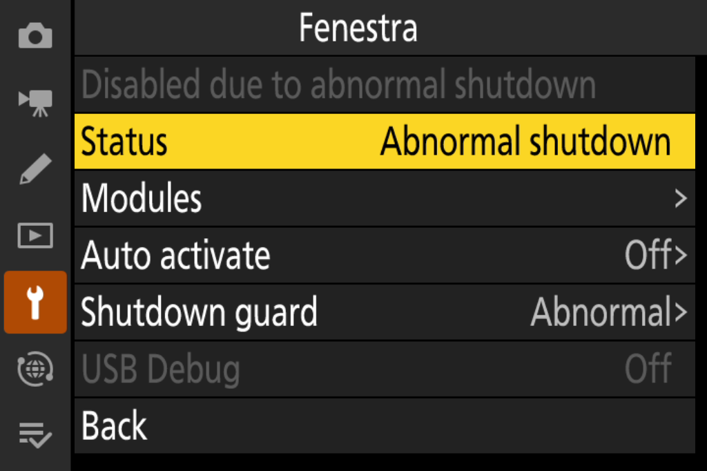
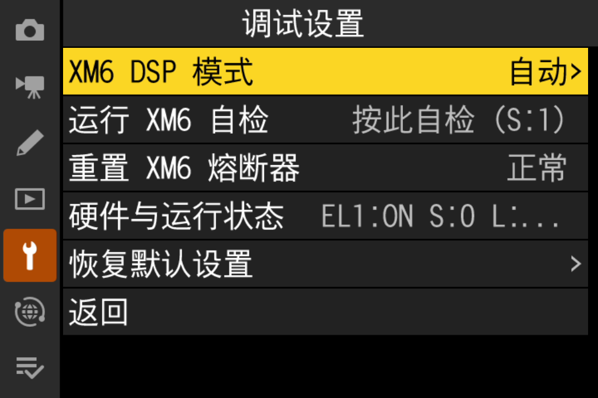
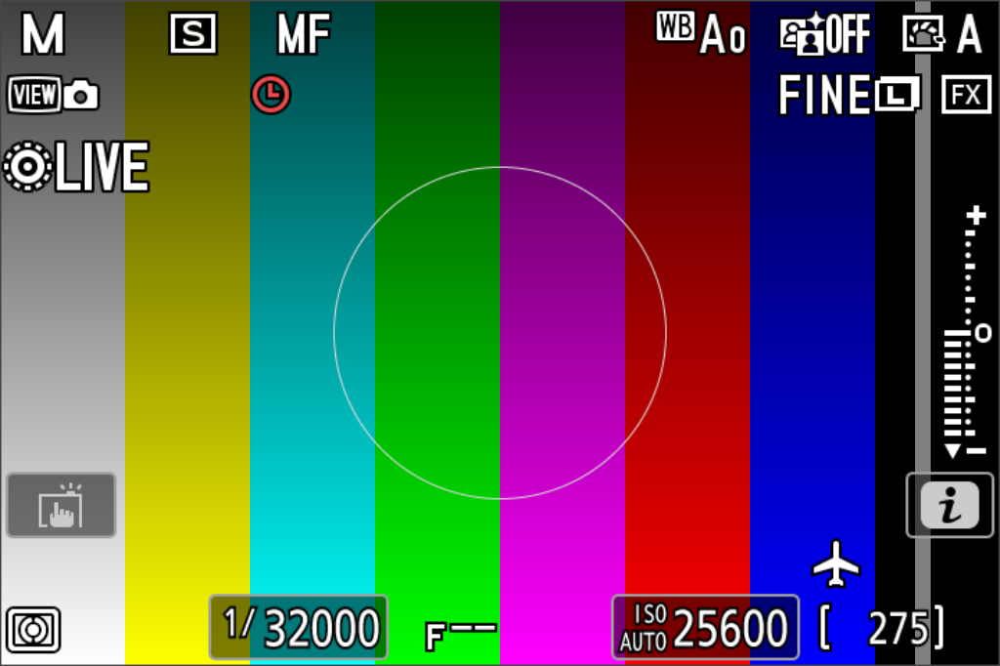
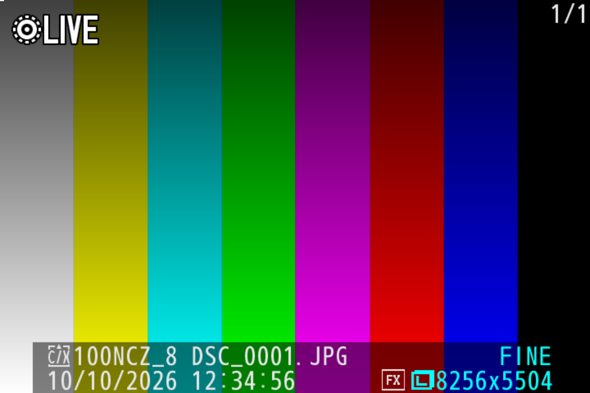
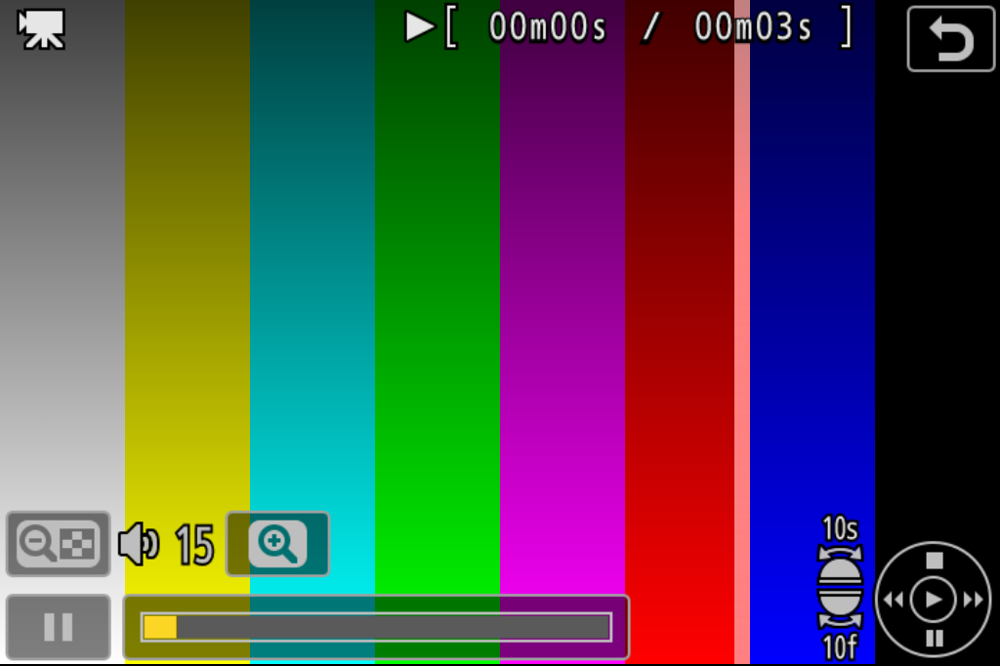
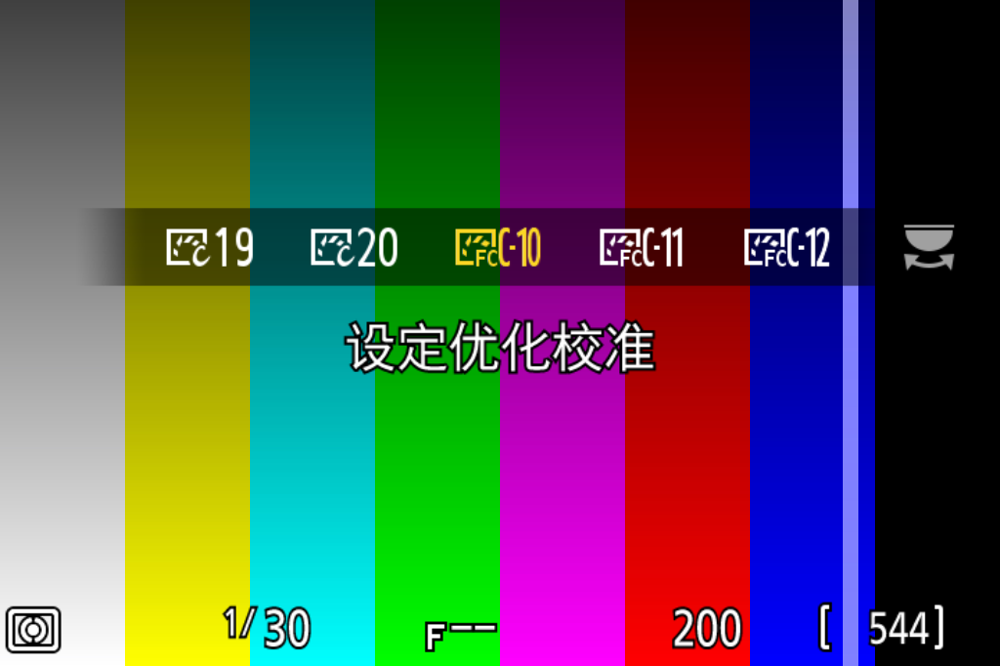
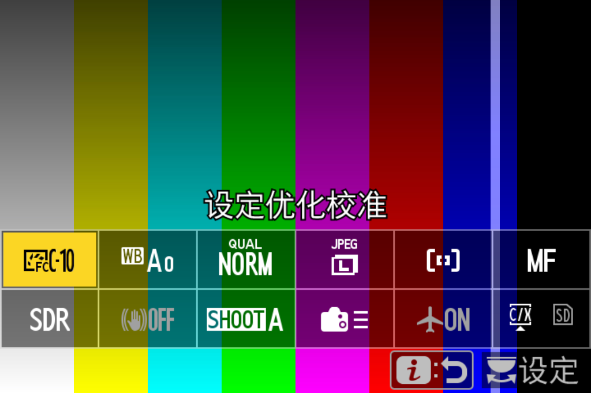
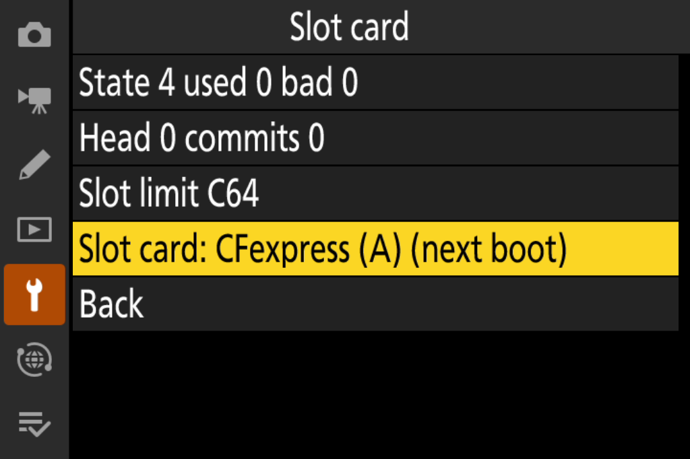
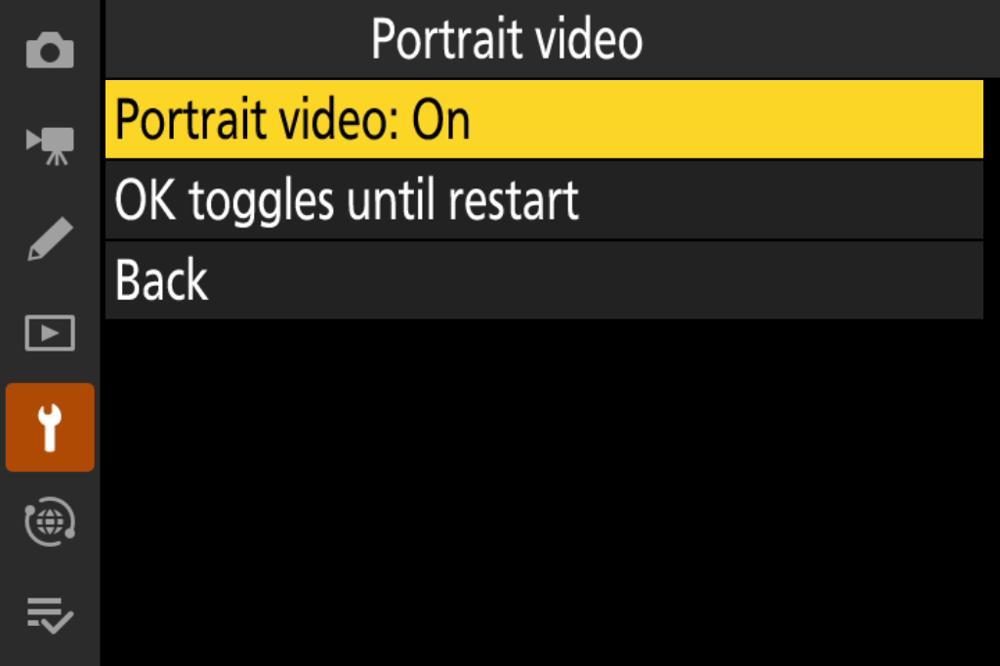
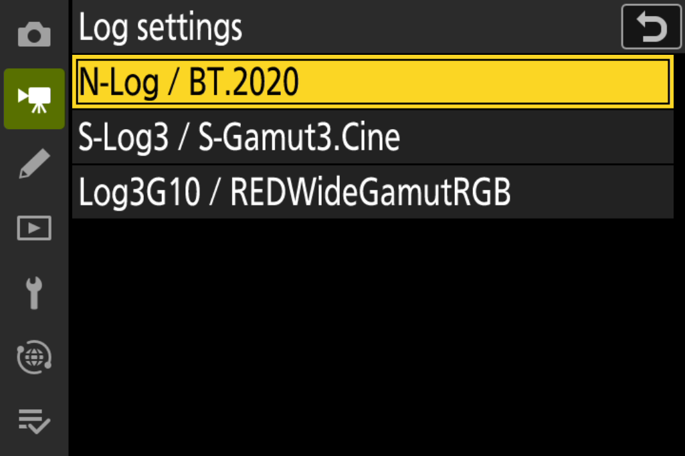

# Fenestra Z8 (`C3.11`) — V71.7-r7 Complete Feature & Menu Reference

**English** | [简体中文](features-and-usage.zh-CN.md) | [Back to README](../README.md)

This manual is the exhaustive user, menu-by-menu setting, card-deployment, diagnostic, and developer reference for the **Nikon Z8 (`C3.11`)** Fenestra firmware line at **`V71.7-r7`** (`Z8-v71.7r7-LutPreview-362ee2a5`, internal `04.06.p0`, Bootguard Build ID `0x8394568f`), documenting every menu item, subpage, option, and default across the native Nikon Photo Shooting Menu 3D LUT browser and all **5 built-in `.wlm` plugins**.

## Table of Contents

1. [Release Identity, Repository Scope & Honest Verification Status](#1-release-identity-repository-scope--honest-verification-status)
2. [Memory Card Layout, Installation & Safe Upgrade Matrix](#2-memory-card-layout-installation--safe-upgrade-matrix)
3. [Clean 7-Row `Fenestra` Home, `Plugin Manager` & Trilingual CJK UI (`FontCJK-ZhUI`)](#3-clean-7-row-fenestra-home-plugin-manager--trilingual-cjk-ui-fontcjk-zhui)
4. [Real-Time 3D LUT Preview (Native Photo Menu Row 47 + `lut.wlm`)](#4-real-time-3d-lut-preview-native-photo-menu-row-47--lutwlm)
5. [Film Simulation, Nikon Zf Grain, Ricoh Optical HDF & EXPEED 7 CEVA-XM6 DSP (`filmsim.wlm`)](#5-film-simulation-nikon-zf-grain-ricoh-optical-hdf--expeed-7-ceva-xm6-dsp-filmsimwlm)
6. [Silky 30 fps Full-Duplex Live Photo (`livephoto.wlm`), Reverse `Layer 0 → Live` & Post-Shutter Deferral](#6-silky-30-fps-full-duplex-live-photo-livephotowlm-reverse-layer-0--live--post-shutter-deferral)
7. [C64 Dual-Card Picture Control Plugin (`slotcard.wlm`) & Native Cloud Icons](#7-c64-dual-card-picture-control-plugin-slotcardwlm--native-cloud-icons)
8. [Portrait Video Runtime Gate (`portrait.wlm`) & Vertical Video HUD](#8-portrait-video-runtime-gate-portraitwlm--vertical-video-hud)
9. [Troubleshooting & Diagnostic Playbook](#9-troubleshooting--diagnostic-playbook)
10. [Developer Reference: Core SDK, `from-stock` (`v36`), `V62` Archive & Source Audit](#10-developer-reference-core-sdk-from-stock-v36-v62-archive--source-audit)

---

## 1. Release Identity, Repository Scope & Honest Verification Status

### 1.1 `V71.7-r7` Release Identity

| Field | Value |
| :--- | :--- |
| **Release Package** | **`Z8-v71.7r7-LutPreview-362ee2a5`** (`V71.7-r7`) |
| **Base Official Firmware** | Nikon Z8 **`C3.11`** (`Z_8_0311.bin`, `99,051,117` bytes) |
| **Internal Firmware Identity** | `04.06.p0` |
| **Bootguard Build ID** | `0x8394568f` (at `0x401FE060`) |
| **MAIN (`eg2070`) SHA-256** | `362ee2a5491859a762b35ed8459cf22c212ae5babb38915daa15e3b801533c8a` (`81,807,709 B`) |
| **XM6 Core 0 ELF0 Footprint** | `.text.z8fx = 156,736 / 158,336 B`, `.rodata.z8fx = 2,016 / 2,048 B` |
| **Bundled Card Plugins (`FENESTRA/`)** | `filmsim.wlm` (`32,540 B`), `livephoto.wlm` (`15,860 B`), `lut.wlm` (`15,624 B`), `slotcard.wlm` (`56,552 B`), `portrait.wlm` (`7,348 B`) |
| **Physical Camera Status** | **`physical_camera_verified = false`** (pending physical Z8 flash & field verification) |

### 1.2 Four `V71.7-r7` Fluency Root-Fixes

Driven by real-camera `V71.1–V71.6` USB read-only profiling and Live `.MOV` frame-timing captures:

1. **XM6 Bridge De-Contention (Eliminating ~21–22.5% `ERR_NOT_READY` Fallbacks)**: Splits pre-lock static readiness from locked mailbox-idle waiting (up to `16 ms` queuing + `dly_tsk(0)` waiter handoff) and hoists IOMMU mapping + pre-submit D-Cache clean/invalidate before `xm6_busy`, minimizing lock hold duration.
2. **Reverse Single-Pass `Layer 0 → Live` Sharing (EVF `1280×852` & LCD `1024×682`)**: When LUT / Layer 0 preview is active, Layer 0 pushes pre-grain LUT+HDF NV12 frames into Live `LBUF` as `FS_TB_GRADED_READY` at `>= 18 ms` cadence. CPU0 skips duplicate scaling/submission, `live_worker` and XM6 skip redundant grading/HDF, and LCD preview is no longer capped at 30 fps by legacy `Live → LCD` sharing.
3. **528 KiB L2-Resident Pre-Baked `64×64×33` YCbCr 3D LUT + Inline NEON Copy + Fused Grain Cache Clean**: Carved from the unused tail of `photo_workspace` (`stage_cpu + 0x80000`) with **`0 B` heap growth** (Class `0x24` strictly frozen at `0xE8C000`), `2×2` Bayer chroma dithering + 3-bit Y linear interpolation (zero neutral-gray cast, NEON == Scalar `0-diff`), plus adaptive 30 fps EVF pacing only when standalone Live runs without reverse sharing.
4. **Post-Shutter 45.4MP Still Deferral**: While `live_runtime_post_roll_active()` is true and the 2-slot burst queue is not full, 45.4MP still `PENDING → COPY` defers until Live post-roll finishes (hard-capped at `1.65 s`), keeping post-shutter Live `.MOV` tail frames at `29.97 fps` instead of freezing.

### 1.3 Honest Verification Status & Boundaries

> [!IMPORTANT]
> - **No prebuilt firmware binaries, Nikon signing/encryption keys, or extracted `ZF_GRAIN.BIN` tables are distributed in `fenestra-z8`.**
> - **`V71.7-r7` (`362ee2a5`) Automated Verification Receipts**:
>   - **CEVA-XM6 `dcli.exe`**: `51/51 PASS` (`GRAIN 25/25` + `HDF 26/26`, `0-diff`).
>   - **0-Q-Spill Static Audit**: `1,114` linked functions, `q_spills = 0`.
>   - **Host ASan + UBSan**: `lut_core` 8/8, `xm6_bridge` 9/9, `layer0` 9/9, `photo_menu` 6/6.
>   - **ARM64 / Unicorn (6 Suites)**: Suite #5 FontCJK (`3,755/3,755` SC + TC), Suite #14 Layer0 (`63` checks), XM6 Bridge (`124` checks, `0` forbidden hits), Suite #4 FilmSim (`70` checks), Suite #2 HangFix, and 5-WLM CJK glyph audit (`0` missing SC/TC).
>   - **Whole-Guest `z8-qemu`**: `#19-r7` `14/14 PASS` (7-row Fenestra + 5 plugins + XM6 self-test/persistence/fallback) & `#20-r7` `13/13 PASS` (Row 47 streaming `.cube` LUT + Layer 0 528 KiB baked LUT + Still + Movie `pool_suspend 0 B` + reboot restore/clear), `z8_unk = 0`, `panic = 0`.
> - **Physical Camera Status**: **`physical_camera_verified = false`** for `V71.7-r7` (`362ee2a5`). QEMU models `1024×682` LCD scanout only (no physical `1280×960` EVF OLED/eye-sensor) and synchronous Wave5 (`avg_wait=0`); real EVF/LCD fps, XM6 fallback rate, and post-shutter Live `.MOV` cadence must be confirmed on a physical Nikon Z8.

---

## 2. Memory Card Layout, Installation & Safe Upgrade Matrix

### 2.1 Complete Card File Reference (`V71.7-r7`)

| Path from Card Root | Exact Size / Format | Category | Purpose & Handling Rules |
| :--- | :--- | :--- | :--- |
| `Z_8_0406.bin` | Update container | Update only | Place at card root **only** during `Setup → Firmware version → Update`. Delete afterward. |
| `FENESTRA/STARTUP-Z8.0` | `64 B` | Shipping (1/7) | Fenestra boot and auto-activate configuration. |
| `FENESTRA/filmsim.wlm` | `32,540 B` | Shipping (2/7) | Zf Grain / Ricoh HDF / XM6 DSP / Per-NP3 Recipe Binding plugin (EN/ZH-CN/ZH-TW). |
| `FENESTRA/livephoto.wlm` | `15,860 B` | Shipping (3/7) | Live Photo, Full-Duplex Shutter Sound, Playback Key & debug stats plugin. |
| `FENESTRA/lut.wlm` | `15,624 B` | Shipping (4/7) | Real-Time 3D LUT switches, clear action & Layer 0 debug plugin. |
| `FENESTRA/slotcard.wlm` | `56,552 B` | Shipping (5/7) | Dual-card C32/C64 Picture Control plugin (`FX_TIMEOUT` hardened + `Debug Settings`). |
| `FENESTRA/portrait.wlm` | `7,348 B` | Shipping (6/7) | Portrait Video runtime gate + `Debug Settings` plugin. |
| `FENESTRA/ZF_GRAIN.BIN` | `27,588 B` (`ZFG1` + CRC32) | Shipping (7/7) | Nikon Zf C3.01 silver-halide grain map (user-supplied; required when `Grain Intensity > Off`). |
| `FENESTRA/LUTS/<cat>/*.cube` | Up to `2 MiB` each | Optional | Categorized 3D/1D `.cube` LUTs browsable in Photo Shooting Menu Row 47 (1-level folders). |
| `FENESTRA/*.cube` | Up to `2 MiB` each | Optional | Flat `.cube` LUTs listed under `Root LUTs` (`根目录 LUT`) in Photo Shooting Menu Row 47. |
| `FENESTRA/FXPHOTO0.CFG`, `FXPHOTO1.CFG` | `96 B` (`FXPHOTO` + CRC32) | Auto-managed | Dual-slot atomic active 3D LUT path persistence (`FXPHOTO.TMP` staging). |
| `FENESTRA/FXLUT0.CFG`, `FXLUT1.CFG` | `32 B` (`ZLT1` + CRC32) | Auto-managed | Dual-slot `lut.wlm` switches (`master_on`, `preview_on`, `still_on`, `live_on`). |
| `FENESTRA/FLMSIM0.CFG`, `FLMSIM1.CFG` | `64 B` (`ZFS1` + CRC32) | Auto-managed | Dual-slot global FilmSim / HDF / XM6 DSP / WYSIWYG settings. |
| `FENESTRA/FLMREC0.CFG`, `FLMREC1.CFG` | 95-slot table + CRC32 | Auto-managed | Dual-slot Per-NP3 recipe binding table (`C-1..C-64` & stock Picture Controls). |
| `FENESTRA/SLTCARD0.CFG`, `SLTCARD1.CFG` | `32 B` (`ZSC1` + CRC32) | Auto-managed | Dual-slot C64 drive selector (`Auto / A / B`). |
| `FENESTRA/SCSEL0.CFG`, `SCSEL1.CFG` | `64 B` + CRC32 | Auto-managed | Dual-slot C64 active slot persistence (`Fn` + Dial). |
| `FENESTRA/SC*.REC` | Atomic generational store | Auto-managed | Card-backed `C-10..C-64` Picture Control records (with `+0x39C` `'Z8FX'` recipe embed). |
| `FENESTRA/live-z8.0`, `live-z8.1` | `64 B` (`FLP1` + CRC32) | Auto-managed | Dual-slot Live Photo configuration (`enable`, `shutter sound`, `playback key`). |
| `FENESTRA/XM6_DIAG.LOG`, `LIVELOG.BIN` | ASCII / binary logs | On-demand | Diagnostic logs written when triggered from `filmsim.wlm` / `livephoto.wlm` Debug subpages. |
| `DCIM/<folder>/DSC_xxxx.NEF` / `.JPG` | Native Nikon still | Camera-written | Native still photo. **14-bit `.NEF` is always `0-diff` untouched.** |
| `LIVE/<folder>/DSC_xxxx.MOV` | `1280×852` HEVC + 48 kHz 24-bit stereo PCM | Camera-written | Paired ~3 s Live Photo video + audio clip. |
| `LIVEDATA/<folder>/DSC_xxxx.{MAN,LVP}` | Internal binary | Camera-written | In-camera pairing manifest & preview index. |

### 2.2 Safe Upgrade Matrix

| Upgrading From | What to Replace | What to Keep Untouched |
| :--- | :--- | :--- |
| **`V71.7-r6` → `V71.7-r7`** | **`Z_8_0406.bin` only** (all 7 files in `FENESTRA/` are byte-identical to `r6`; delete `Z_8_0406.bin` afterward) | Everything in `FENESTRA/`, `DCIM/`, `LIVE/`, `LIVEDATA/` |
| **`V71.7-r5` or earlier → `V71.7-r7`** | `Z_8_0406.bin` **AND all 7 shipping files** in `FENESTRA/` (`STARTUP-Z8.0`, 5 `.wlm` plugins, `ZF_GRAIN.BIN`) | `DCIM/`, `LIVE/`, `LIVEDATA/`, `LUTS/`, `FXPHOTO*.CFG`, `FXLUT*.CFG`, `FLMSIM*.CFG`, `FLMREC*.CFG`, `SLTCARD*.CFG`, `SCSEL*.CFG`, `SC*.REC`, `live-z8.*` |
| **Fresh Install** | Copy `Z_8_0406.bin` to root + 7 shipping files to `FENESTRA/` (+ optional `.cube` files in `FENESTRA/LUTS/<cat>/`), run firmware update with a full battery, delete `Z_8_0406.bin` | N/A |

---

## 3. Clean 7-Row `Fenestra` Home, `Plugin Manager` & Trilingual CJK UI (`FontCJK-ZhUI`)

| Clean 7-Row `Fenestra` Home | `Plugin Manager` (5 `.wlm` Plugins) | Abnormal Shutdown Guard |
| :---: | :---: | :---: |
|  |  |  |

- **Clean 7-Row `Fenestra` Home**: Starting in `V71.7`, Live Photo controls moved into their own dedicated `livephoto.wlm` plugin inside `Plugin Manager`, keeping `Setup Menu → Fenestra` clean and uncluttered (7 rows: `Status`, `Activate`, `Auto activate`, `Shutdown guard`, `Modules`, etc.).
- **Trilingual `Plugin Manager` (`插件管理`) & `FontCJK-ZhUI`**:
  - Setup Menu string ID `3155` renders as **`Plugin Manager`** (EN) / **`插件管理`** (ZH-CN & ZH-TW); `Fenestra → Modules` (ID `3165`) renders as **`Modules`** / **`已加载插件`** / **`已載入插件`**.
  - `FontCJK-ZhUI` hooks `set_primary_font` to chain stock ASCII `Font[18]` with `CJK_EXT_1` + `CJK_EXT_2` (`3,755/3,755` SC + `3,755/3,755` TC, `0` missing glyphs across all 5 plugins), leaving English and stock Nikon strings 100% untouched.
  - All 5 `.wlm` plugins poll `slots.state` op `15` (`SLOTS_LANG_GET`, magic `'LANG'`) every `1 s` (`8 = 简体中文`, `9 = 繁體中文`, other = English) so changing `Setup Menu → Language` updates every plugin page live with **no reboot**.
- **Enabling/Disabling & Boot Guard**: Toggle plugins in `Setup → Fenestra → Modules` (disabled files become `.wlm.disabled` on next boot). If a power loss or crash occurs while active, the boot guard halts loading (`Disabled due to abnormal shutdown`); clear the flag in `Shutdown guard` to resume.

---

## 4. Real-Time 3D LUT Preview (Native Photo Menu Row 47 + `lut.wlm`)

| Photo Shooting Menu Row 47 (`Select LUT`) | Category Picker (`FENESTRA/LUTS/`) | `.cube` File List (20/page) |
| :---: | :---: | :---: |
|  |  |  |
| **Loaded 3D LUT Status** | **Live View with Real-Time 3D LUT** | **`lut.wlm` Root Menu** |
|  |  |  |

### 4.1 Native Photo Shooting Menu Row 47 (`Select LUT` / `选择 LUT`)

- **Menu Entry**: Photo Shooting Menu **Row 47** (`0x2DE7`), localized in 4 languages: `Select LUT` (EN) / `选择 LUT` (ZH-CN) / `選擇 LUT` (ZH-TW) / `LUT 選択` (JA).
  - Dynamically reflects `lut.wlm` state: if `lut.wlm` is disabled it shows `Select LUT (Off)` (`选择 LUT (未启用)`); if `3D LUT Enable` is Off it shows `Select LUT (Off)` (`选择 LUT (已关闭)`).
- **23-Row Paginated Submenu (`Page 0x5D6`)**:
  - **Row 0**: `Off` (`无LUT` / `無LUT` / `OFF`) at root level, or `Back` (`返回上一级` / `返回上一層` / `戻る`) inside a category folder.
  - **Rows 1–20**: Up to 20 category folders (root level) or `.cube` files (inside a category or `Root LUTs` / `根目录 LUT`), sorted alphabetically.
  - **Row 21 / Row 22**: `Prev` (`上一页`) / `Next` (`下一页`) pagination controls when more than 20 items exist.
  - **Header Status Line**: Shows live worker phase (`No LUT`, `Loading`, `Reading`, `Preparing <0..100%>`, `Ready`, `LUT file missing`, `Invalid LUT file`, `Insufficient memory`, `LUT plugin off`, `3D LUT Off`).
- **Built-In Localized Category Folder Names (`FENESTRA/LUTS/<folder>/`)**:
  - `01-Fuji-Film` (`FUJI 色调`), `02-Kodak-Negative` (`Kodak 负片`), `03-Classic-Negative` (`传统负片`), `04-Color-Slide` (`彩色反转片`), `05-Black-and-White` (`黑白片`), `06-Instant-Polaroid` (`拍立得即显`), `07-Cinema-Print` (`电影色调`), `08-Camera-Style` (`相机直出与机内风格`), `09-Portrait-Daily` (`人像与日常拍摄`), `10-Creative-Vintage` (`创意色调`) — plus any custom ASCII subfolder name.
- **Format & Persistence**: Directly streams standard `.cube` files (up to `2 MiB` each; 3D LUTs evaluated via the `V71.7-r7` **528 KiB L2 pre-baked `64×64×33` YCbCr LUT** with `2×2` Bayer chroma dithering + 3-bit Y linear interpolation, and 1D-separable LUTs routed to `1D-XM6`). Selection persists in dual-slot CRC32 `FXPHOTO0.CFG` / `FXPHOTO1.CFG` across cold reboots. *(Legacy `V71.2` `.Z8LUT` Fuji slot files are superseded by direct `.cube` streaming.)*

### 4.2 Complete `lut.wlm` Menu & Debug Subpage Reference (13 Controls)

| # | Page / Level | English | 简体中文 | 繁體中文 | Type / Options | Default | Description |
| :-: | :--- | :--- | :--- | :--- | :--- | :---: | :--- |
| 1 | Root Page | `3D LUT` | `3D LUT 调色` | `3D LUT 調色` | Root page | — | Entry page inside `Plugin Manager`. |
| 2 | Root | `3D LUT Enable` | `3D LUT 开关` | `3D LUT 開關` | Switch (`On` / `Off`) | **`On`** | Master 3D LUT gate (persisted in `FXLUT0/1.CFG`). Turning `Off` also suspends Photo Menu Row 47. |
| 3 | Root | `Active LUT` | `当前 LUT` | `目前 LUT` | Read-only status | `None` | Shows active `.cube` basename or `None (Select in Photo Menu)`. |
| 4 | Root | `Live View Preview` | `取景实时预览` | `取景即時預覽` | Switch (`On` / `Off`) | **`On`** | Gates real-time Layer 0 EVF & LCD LUT preview. |
| 5 | Root | `Still JPEG LUT` | `照片 LUT` | `照片 LUT` | Switch (`On` / `Off`) | **`On`** | Gates Stage 0 LUT grading on 45.4MP JPEG stills (14-bit `.NEF` is never modified). |
| 6 | Root | `Live Photo LUT` | `实况照片 LUT` | `實況照片 LUT` | Switch (`On` / `Off`) | **`On`** | Gates Stage 0 LUT grading on `1280×852` HEVC Live Photo clips. |
| 7 | Root | `Clear Active LUT` | `清除当前 LUT` | `清除目前 LUT` | Action (`Tap to Clear`) | — | Unloads the active LUT and clears `FXPHOTO0/1.CFG`. |
| 8 | Root → Subpage | `Debug Settings` | `调试设置` | `調試設定` | Subpage | — | Opens the 5-row Layer 0 & LUT telemetry subpage. |
| 9 | Debug | `Pipeline & Accel` | `管线与加速` | `管線與加速` | Read-only telemetry | — | `<OFF\|IDLE\|1D-XM6\|3D-NEON\|3D-CPU> C<cores> Gen:<n>`. |
| 10 | Debug | `Layer 0 Preview` | `图层 0 预览` | `圖層 0 預覽` | Read-only telemetry | — | `WS:<MiB>M <fps>fps Sub:<submitted> REJ:<rejected>`. |
| 11 | Debug | `Health & Drive` | `健康与隔离` | `健康與隔離` | Read-only telemetry | — | `NEON:<0\|1> Q:<quarantined> Pool:<rc> [A\|B]`. |
| 12 | Debug | `Watchdog` | `看门狗状态` | `看門狗狀態` | Read-only telemetry | — | `WD:<polls> Phase:<worker_phase> Err:<last_result>`. |
| 13 | Debug | `Reset Preview Pool` | `重置预览工作区` | `重設預覽工作區` | Action (`Tap to Reset`) | — | Triggers `LUT_OP_RESET_PREVIEW` to re-initialize the Layer 0 preview workspace (blocked if quarantined). |

---

## 5. Film Simulation, Nikon Zf Grain, Ricoh Optical HDF & EXPEED 7 CEVA-XM6 DSP (`filmsim.wlm`)

| `filmsim.wlm` Root Menu | `filmsim.wlm` Debug & XM6 Subpage | EXPEED 7 CEVA-XM6 Self-Test Readout |
| :---: | :---: | :---: |
|  |  |  |

### 5.1 Optical Pipeline Order, EXPEED 7 CEVA-XM6 DSP & Per-NP3 Recipe Binding

- **Strict Optical Order**: `Stage 0 (3D LUT)` → `Stage 1 (Ricoh Optical HDF in linear light)` → `Stage 2 (Nikon Zf C3.01 18-level Silver-Halide Grain on top)`. **14-bit `.NEF` RAW is always `0-diff` untouched.**
- **EXPEED 7 CEVA-XM6 Hardware DSP (`Slot 39/40/41`)**:
  - Coexists inside stock `z8_xm6_elf0.elf` with zero growth (`51/51` `dcli.exe` PASS, `0-diff`).
  - `V71.7-r7` de-contention splits static HW-ready from locked mailbox-idle waiting (up to `16 ms` + `dly_tsk(0)` handoff) and hoists IOMMU/D-Cache ops outside `xm6_busy`, eliminating the ~21% `ERR_NOT_READY` fallback observed on `V71.7-r6`.
  - Built-in circuit breaker automatically falls back to bit-exact ARM NEON on any DSP error.
- **Per-NP3 Recipe Binding (95 Slots)**: Bind Grain + HDF + Live Photo Link independently to every stock Picture Control and `C-1..C-64` slot (`FLMREC0/1.CFG` + `SC*.REC +0x39C` `'Z8FX'`). Unbound Picture Controls automatically enter `0 B` dormant bypass.

### 5.2 Complete `filmsim.wlm` Menu & Debug Subpage Reference (16 Controls)

| # | Page / Level | English | 简体中文 | 繁體中文 | Type / Options | Default | Description |
| :-: | :--- | :--- | :--- | :--- | :--- | :---: | :--- |
| 1 | Root Page | `Film Simulation` | `胶片模拟 / HDF` | `膠片模擬 / HDF` | Root page | — | Entry page inside `Plugin Manager`. |
| 2 | Root | `Apply Mode` | `生效模式` | `生效模式` | `Global` / `Per-NP3` (`全局生效` / `按优化校准`) | **`Global`** | `Global` applies settings to all profiles; `Per-NP3` applies per-slot bound recipes and stays `0 B` dormant on unbound profiles. |
| 3 | Root | `Grain Intensity` | `颗粒强度` | `顆粒強度` | `Off`, `1`, `2`, `3`, `4`, `5`, `6` | **`Off`** | Nikon Zf C3.01 silver-halide grain strength (6 intensities × 3 sizes = 18 levels; requires `ZF_GRAIN.BIN`). |
| 4 | Root | `Grain Size` | `颗粒大小` | `顆粒大小` | `1 (Small)` / `2 (Medium)` / `3 (Large)` | **`2 (Medium)`** | Physical grain clump size (`1` ≈ ISO 100–200, `2` ≈ ISO 400, `3` ≈ pushed ISO 1600–3200). |
| 5 | Root | `Grain Texture` | `颗粒质感` | `顆粒質感` | `Soft (Zf)` / `Sharp` (`柔和 (Zf)` / `清晰`) | **`Sharp`** | **`Sharp` (default)**: blurs only the signed grain delta, preserving 100% native 45.4MP sharpness. `Soft (Zf)`: bit-exact Zf `BlurLineRing`. |
| 6 | Root | `HDF Level` | `高光柔焦 HDF` | `高光柔焦 HDF` | `Off` / `Weak (1/8)` / `Medium (1/4)` / `Strong (1/2)` | **`Off`** | Linear-light multi-scale optical Highlight Diffusion Filter (works standalone or stacked with Grain & 3D LUT). |
| 7 | Root | `Live Photo Link` | `实况照片联动` | `實況照片聯動` | Switch (`Off` / `On`) | **`Off`** | Applies active Grain & HDF recipe in real time to `1280×852` HEVC Live Photo clips. |
| 8 | Root | `WYSIWYG Preview` | `取景实时预览` | `取景即時預覽` | Switch (`Off` / `On`) | **`Off`** | Enables live EVF/LCD preview of HDF & Grain via Layer 0. |
| 9 | Root | `Bind Active NP3` | `绑定当前配方` | `關聯目前配方` | Action (`<PC> [Bound\|None]`) | — | Saves current Grain / HDF / Live Link settings to the active Picture Control (`FLMREC0/1.CFG` + `SC*.REC +0x39C`). |
| 10 | Root | `Clear Active NP3` | `清除当前配方` | `清除目前配方` | Action (`Bound:<n>`) | — | Clears the recipe binding from the currently selected Picture Control. |
| 11 | Root → Subpage | `Debug Settings` | `调试设置` | `調試設定` | Subpage | — | Opens the 5-row XM6 Hardware DSP & diagnostics subpage. |
| 12 | Debug | `XM6 DSP Mode` | `XM6 DSP 模式` | `XM6 DSP 模式` | `Auto` / `CPU Only` (`自动` / `仅 CPU`) | **`Auto`** | `Auto` uses EXPEED 7 CEVA-XM6 DSP with automatic NEON fallback; `CPU Only` forces ARM NEON. |
| 13 | Debug | `Run XM6 Self-Test` | `运行 XM6 自检` | `執行 XM6 自檢` | Action (`Tap to Run`) | — | Runs 4-case `0-diff` XM6 vs ARM verification (`Grain Exact`, `Grain Sharp`, `HDF Still`, `HDF Live`), displays `XM6 PASS 0err G:<ms> H:<ms> S:<ms>`, and writes `FENESTRA/XM6_DIAG.LOG`. |
| 14 | Debug | `Reset XM6 Breaker` | `重置 XM6 熔断器` | `重設 XM6 熔斷器` | Action (`OK` / `Tripped E:<n>`) | — | Clears a tripped XM6 safety breaker so DSP offload can resume. |
| 15 | Debug | `Hardware & Runtime` | `硬件与运行状态` | `硬體與運行狀態` | Read-only telemetry | — | `EL1:<ON\|DM\|IN\|E#> S:<stills> L:<live> XM6:<OK ok/fb\|CPU\|NO\|TR\|LF> [A\|B]`. |
| 16 | Debug | `Reset Defaults` | `恢复默认设置` | `還原預設設定` | Modal (`Restore defaults?`) | — | Restores all global FilmSim / HDF / XM6 defaults and writes `FLMSIM0/1.CFG`. |

---

## 6. Silky 30 fps Full-Duplex Live Photo (`livephoto.wlm`), Reverse `Layer 0 → Live` & Post-Shutter Deferral

| `livephoto.wlm` Root Menu | LCD Live View (`◎LIVE`) | Photo Playback (`◎LIVE`) | Native `REC` MOV Player |
| :---: | :---: | :---: | :---: |
|  |  |  |  |

### 6.1 Complete `livephoto.wlm` Menu & Debug Subpage Reference (11 Controls)

| # | Page / Level | English | 简体中文 | 繁體中文 | Type / Options | Default | Description |
| :-: | :--- | :--- | :--- | :--- | :--- | :---: | :--- |
| 1 | Root Page | `Live Photo` | `实况照片` | `實況照片` | Root page | — | Entry page inside `Plugin Manager` (persisted in `FENESTRA/live-z8.0` / `live-z8.1`). |
| 2 | Root | `Live Photo` | `实况照片` | `實況照片` | `Off` / `On` (`关闭` / `开启`) | **`Off`** | Master Live Photo capture switch (`1280×852` HEVC + ~3 s rolling ring buffer). |
| 3 | Root | `Shutter Sound` | `快门声音` | `快門聲音` | `On` / `Off` (`开启` / `关闭`) | **`On`** | Full-duplex 48 kHz 24-bit stereo PCM audio with 11 shutter hooks (**`0.0 ms` audio gap**); Nikon Silent Mode always takes priority. |
| 4 | Root | `Playback Key` | `回放按键` | `回放按鍵` | `REC` / `Off` (`REC 键` / `关闭`) | **`REC`** | Pressing `REC` on a `◎LIVE` photo launches Nikon's native video player with audio and returns cleanly to the still (supports dual-card RAW+JPEG). |
| 5 | Root | `Status` | `当前状态` | `目前狀態` | Read-only status | `Off` | `Off` / `Preparing` / `Short Clip` / `Ready` / `Busy` / `Unavailable` / `Card Error`. |
| 6 | Root → Subpage | `Debug Settings` | `调试设置` | `調試設定` | Subpage | — | Opens the 5-row Wave5, Audio, Playback & Log telemetry subpage. |
| 7 | Debug | `Capture Stats` | `录制统计` | `錄製統計` | Read-only telemetry | — | `Tx:<ok>/<err> Enc:<encoded> Drop:<dropped>`. |
| 8 | Debug | `Wave5 & Audio` | `Wave5 与音频` | `Wave5 與音訊` | Read-only telemetry | — | `W5:<ACT\|PARK\|IDLE\|ERR> Aud:<phase>/<tracks>`. |
| 9 | Debug | `Playback & Drive` | `回放与双卡` | `回放與雙卡` | Read-only telemetry | — | `REC:<consumed> PB:<frames>/<err> [A\|B]`. |
| 10 | Debug | `Flag & Log` | `关机保护与日志` | `關機保護與記錄` | Read-only telemetry | — | `Park:<parks>/<restores> Log:<saves> [E:<err>]`. |
| 11 | Debug | `Export LIVELOG.BIN` | `导出诊断日志` | `匯出檢測記錄` | Action (`Tap to Export`) | — | Flushes the in-RAM diagnostic ring buffer to `FENESTRA/LIVELOG.BIN`. |

### 6.2 `V71.7-r7` Pipeline Architecture, HangFix & EVF Fixes

- **Reverse Single-Pass `Layer 0 → Live` Sharing**: When LUT/Layer 0 preview is active on EVF (`1280×852`) or LCD (`1024×682`), Layer 0 pushes pre-grain LUT+HDF NV12 frames directly into Live `LBUF` (`FS_TB_GRADED_READY`), avoiding duplicate CPU2/XM6 grading and lifting the LCD 30 fps cap.
- **Post-Shutter 45.4MP Still Deferral**: Defers 45.4MP still `PENDING → COPY` until Live post-roll completes (hard-capped at `1.65 s`, bypassed when the 2-slot burst queue is full), preventing post-shutter Live `.MOV` tail freezes.
- **HangFix (`L1`/`L2A`/`L2B`), `-24` Quiet-Park & EVF Pool #6 (`0x001C2000`)**: Yields Wave5 and Class `0x24` pools cleanly across Movie/Playback/Power-Off (`~68 ms` `◎LIVE` recovery), preserves EVF Pool #6 `0x001C2000` (eliminating 3:2 green top/bottom edges), and maintains `NCTG 0x0018` upright orientation parity.

---

## 7. C64 Dual-Card Picture Control Plugin (`slotcard.wlm`) & Native Cloud Icons

| `C64` Native Icons (`Fn` Dial Strip) | `C64` Native Icons (`i`-Menu) | Dual-Card `Slot card` (`slotcard.wlm`) |
| :---: | :---: | :---: |
|  |  |  |

`slotcard.wlm` unlocks Nikon Z8 Custom Picture Controls from stock `C-1..C-9` to **32 (`C-1..C-32`)** or **64 (`C-1..C-64`)** slots across Photo and Video, with real-time `kind=1` PNG synthesis rendering unified **`[FC]C-10..C-64`** Cloud icons across 7+ UI surfaces, `Fn` + Command Dial cycling (`SCSEL0/1.CFG`), and the `34.46×` `FX_TIMEOUT (0x7)` fix (`5.65M → 164K` insns on 102 slots).

### Complete `slotcard.wlm` Menu & Debug Subpage Reference (7 Controls)

| # | Page / Level | English | 简体中文 | 繁體中文 | Type / Options | Default | Description |
| :-: | :--- | :--- | :--- | :--- | :--- | :---: | :--- |
| 1 | Root Page | `C64 Filter Slots` *(or `C32`)* | `C64 滤镜槽` | `C64 濾鏡槽` | Root page | — | Entry page inside `Plugin Manager`. |
| 2 | Root | `Slot Limit` | `滤镜槽容量` | `濾鏡槽容量` | `C64 (64)` / `C32 (32)` (`(next boot)`) | **`C64`** | Toggles extended Picture Control slot limit (effective next boot). |
| 3 | Root | `Storage Card` | `存储卡` | `記憶卡` | `Auto` / `CFexpress (A)` / `SD (B)` (`(next boot)`) | **`Auto`** | Persisted in `SLTCARD0/1.CFG`. Strict `CFexpress (A)` or `SD (B)` never writes to the other card and safely stays at `C1–C9` if the target card or `FENESTRA/` is absent. |
| 4 | Root → Subpage | `Debug Settings` | `调试设置` | `調試設定` | Subpage | — | Opens the 3-row slot store & boot-latch diagnostics subpage. |
| 5 | Debug | `Slot State` | `插槽状态` | `插槽狀態` | Read-only telemetry | — | `State <n> used <n> bad <n> [A\|B]` or missing/other-card warnings. |
| 6 | Debug | `Store Journal` | `存储日志` | `存儲記錄` | Read-only telemetry | — | `Head <gen> commits <n>` (atomic `SC<gen>.REC` generation & session commits). |
| 7 | Debug | `Boot Card Latch` | `卡槽引导` | `卡槽引導` | Read-only telemetry | — | `CSL1:<A\|B\|0\|-> Miss:<reason> SEQ:<sel_seq>`. |

---

## 8. Portrait Video Runtime Gate (`portrait.wlm`) & Vertical Video HUD

| `Portrait Video` Gate (`portrait.wlm`) | Portrait Video Recording HUD (`90°`) | Video `Log settings` |
| :---: | :---: | :---: |
|  |  |  |

`portrait.wlm` controls the built-in 8-hook `PortraitPB` vertical video layer (`tkhd` + `NCTG 0x0018` upright rotation metadata, vertical video OSD + real-time histogram alignment, and upright LCD/EVF playback & thumbnails).

### Complete `portrait.wlm` Menu & Debug Subpage Reference (5 Controls)

| # | Page / Level | English | 简体中文 | 繁體中文 | Type / Options | Default | Description |
| :-: | :--- | :--- | :--- | :--- | :--- | :---: | :--- |
| 1 | Root Page | `Portrait Video` | `竖屏录像` | `直拍錄影` | Root page | — | Entry page inside `Plugin Manager`. |
| 2 | Root | `Portrait Video` | `竖屏录像` | `直拍錄影` | Action (`On` / `Off` / `Unavailable`) | **`On`** *(while plugin enabled)* | Press `OK` to toggle `PortraitPB` immediately at runtime with no reboot required. |
| 3 | Root → Subpage | `Debug Settings` | `调试设置` | `調試設定` | Subpage | — | Opens the 2-row runtime gate diagnostics subpage. |
| 4 | Debug | `Runtime Status` | `运行状态` | `運行狀態` | Read-only telemetry | — | `EL1 Gate:<0\|1\|ERR> slots.state:<OK\|ERR>` (press `OK` to refresh). |
| 5 | Debug | `Note` | `说明` | `說明` | Informational | — | `Resets on restart` — runtime toggles do not persist across reboot; disable `portrait.wlm` in `Fenestra → Modules` to turn off permanently. |

---

## 9. Troubleshooting & Diagnostic Playbook

| Symptom / Status Message | Most Likely Cause | Resolution |
| :--- | :--- | :--- |
| Photo Menu Row 47 says `Select LUT (Off)` (`选择 LUT (未启用)` / `(已关闭)`) | `lut.wlm` is disabled in `Modules`, or `3D LUT Enable` is `Off` | Enable `lut.wlm` in `Setup → Fenestra → Modules` (reboot) and set `Plugin Manager → 3D LUT → 3D LUT Enable = On`. |
| `.cube` file not visible in Photo Menu Row 47 | File is `> 2 MiB`, nested deeper than 1 level, or non-ASCII filename | Place `.cube` files (`<= 2 MiB`, ASCII names) directly in `FENESTRA/*.cube` or `FENESTRA/LUTS/<category>/*.cube`. |
| `filmsim.wlm` `Hardware & Runtime` shows `XM6:TR` or `XM6:NO` | XM6 breaker tripped or running in QEMU without physical XM6 silicon | Open `filmsim → Debug Settings → Reset XM6 Breaker` or `Run XM6 Self-Test`; note that ARM NEON fallback stays active automatically. |
| Grain has no effect | `FENESTRA/ZF_GRAIN.BIN` missing/invalid, or `Apply Mode = Per-NP3` on an unbound profile | Verify `27,588 B` `ZF_GRAIN.BIN` (`ZFG1`+CRC32) in `FENESTRA/`; switch `Apply Mode` to `Global` or tap `Bind Active NP3`. |
| `slotcard` shows `Card A/B missing` or `no FENESTRA` | Strict `CFexpress (A)` or `SD (B)` target card lacks `FENESTRA/` or is absent | Insert the target card with a `FENESTRA/` directory, or switch `Storage Card` back to `Auto` and reboot. |
| `Live Photo` shows `Busy` and a rapid second shot has no clip | Previous Live clip was still flushing | Wait for the `◎LIVE` busy sweep to complete before firing the next Live shot. |
| `Disabled due to abnormal shutdown` on boot | Boot guard detected a power loss or crash during a prior active session | Confirm stability, open `Setup → Fenestra → Shutdown guard`, clear the abnormal flag, and re-activate. |

---

## 10. Developer Reference: Core SDK, `from-stock` (`v36`), `V62` Archive & Source Audit

### 10.1 Core Emulation `MAIN` & `.wlm` SDK Builds

```bash
# Build standalone .wlm modules (no Nikon firmware or keys required)
python host/build_sdk_module.py examples/hello/module.c \
  --id hello --target z8-c311 --output-dir build/hello-z8-local

python host/build_sdk_module.py modules/demo/sdk.c \
  --id demo --target z8-c311 --output-dir build/demo-z8-local

# Build QEMU-only Z8 Core MAIN (input: 81,807,709 B stock Z8 C3.11 MAIN,
# SHA-256: 2b43a31c9de838f84b12416de4348a7004e65be07f853ec56ec2b10f3a8e3853)
python host/build_z8_core.py \
  --firmware /absolute/path/to/z8-c311-original-main.bin \
  --output-dir build/z8-core-local
```

- Requires LLVM (`clang`, `ld.lld`, `llvm-objcopy`, `llvm-nm`) targeting `aarch64-none-elf`, plus static-linking `aarch64-linux-gnu-gcc` (or `--agent-cc`).
- Host `INFO` bridge (`host/ptp_linux.py`, `FENESTRA_PTP_PROFILE=z8-c311`) permits only the parameterless `info` query against SHA-256-pinned `fenestra-agent-z8-info`. See [debugging.md](debugging.md) and [PORT-STATUS.md](../port-z8/PORT-STATUS.md).

### 10.2 Reproducible Stock-to-`v36` Reconstruction, `V62` Archive & Source Audit

```bash
# Stock Z_8_0311.bin -> v36.main + Z_8_0406.bin (Clang 18 + Clang/LLVM 21)
python -m pip install -r research/z8-live/from-stock/requirements.txt
python -B research/z8-live/from-stock/build.py \
  --stock /absolute/path/to/Z_8_0311.bin \
  --qemu-root /absolute/path/to/z8-qemu \
  --output-dir /absolute/path/to/v36-rebuilt

# Verify tracked source inventory before committing
python -B verify_source.py
```

- See [from-stock/README.md](../research/z8-live/from-stock/README.md), [RELEASE-v62.md](../research/z8-live/build-tools/livediag/feat-onemov/RELEASE-v62.md), and [C64LABEL-RESULT.md](../research/z8-live/build-tools/livediag/feat-c64label/C64LABEL-RESULT.md).
- **License**: [CC BY-NC-SA 4.0](../LICENSE) with [Commercial Photography Exception](../EXCEPTIONS.md) and [Z8 Adaptation Terms](../LICENSE-Z8.md).
