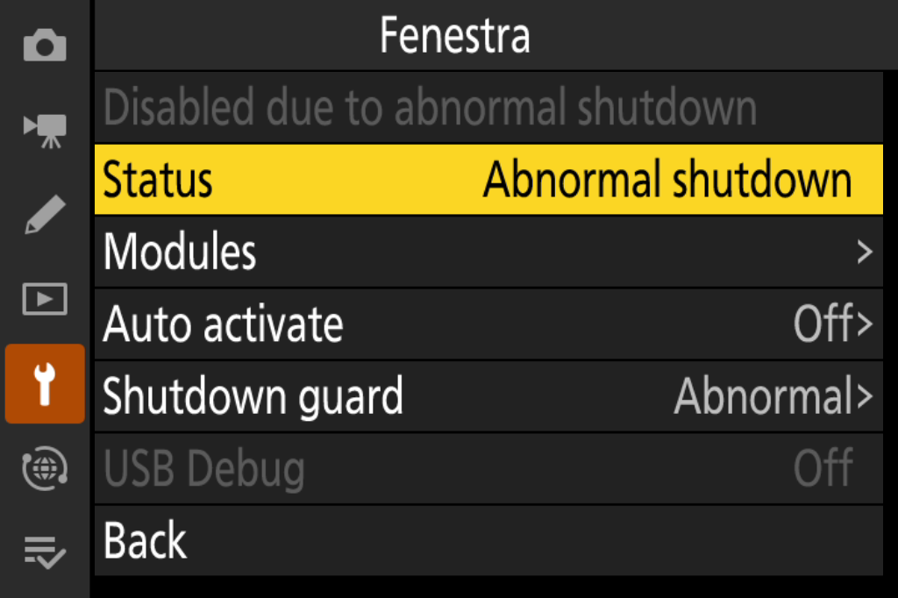
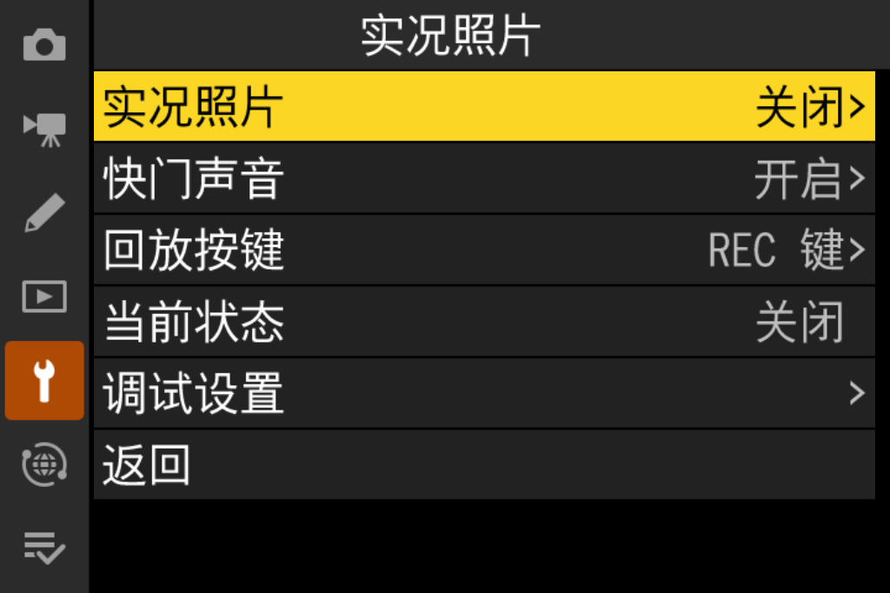
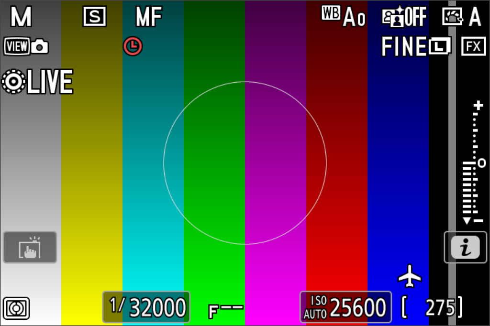
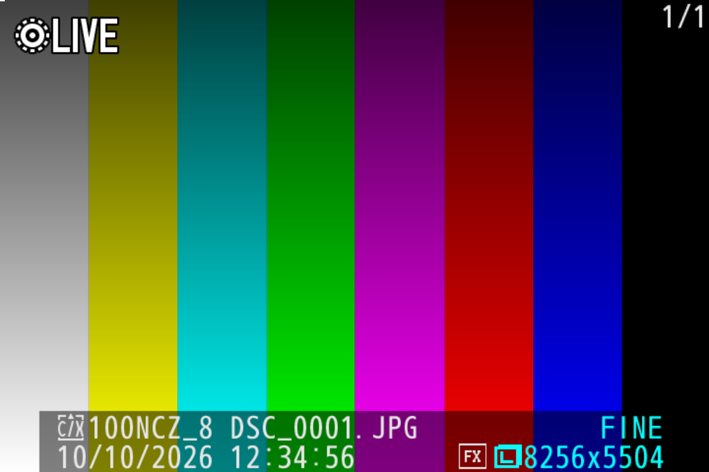
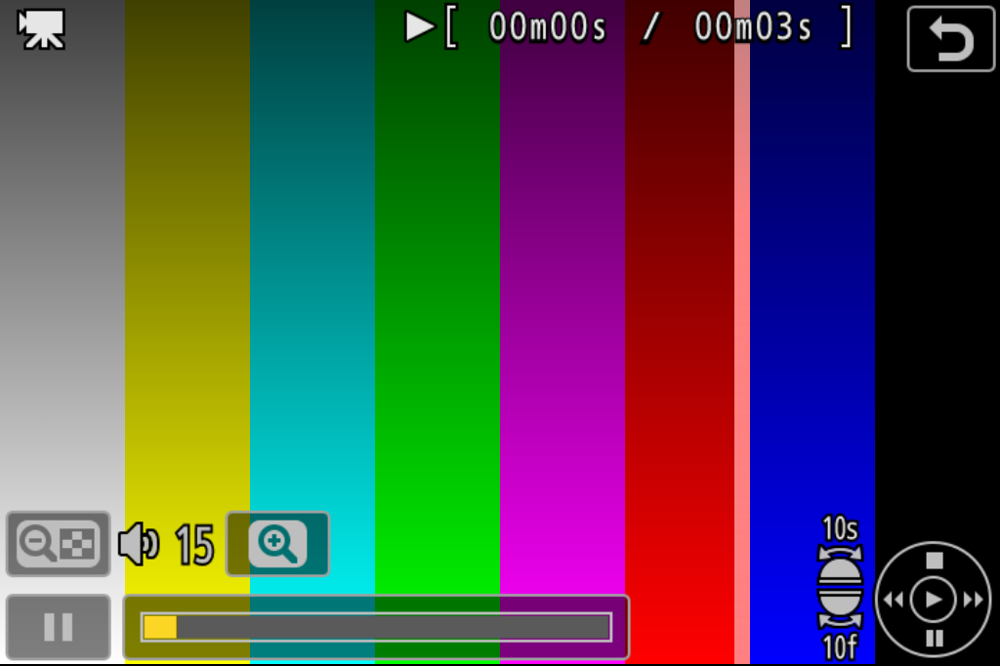
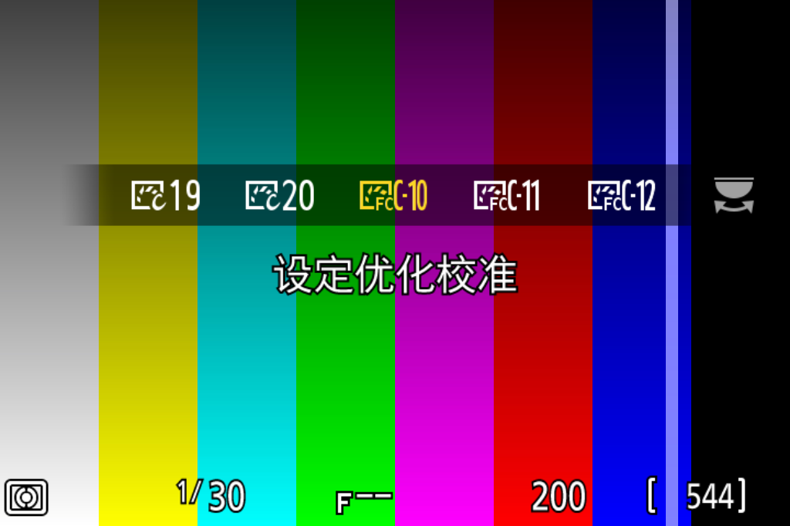
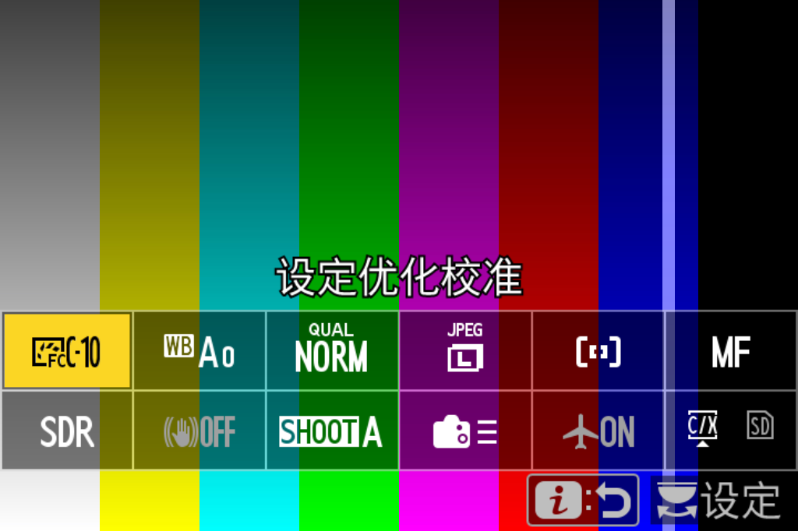
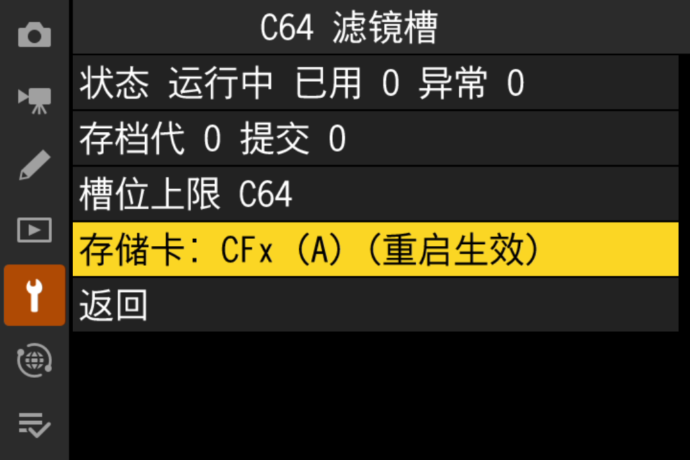
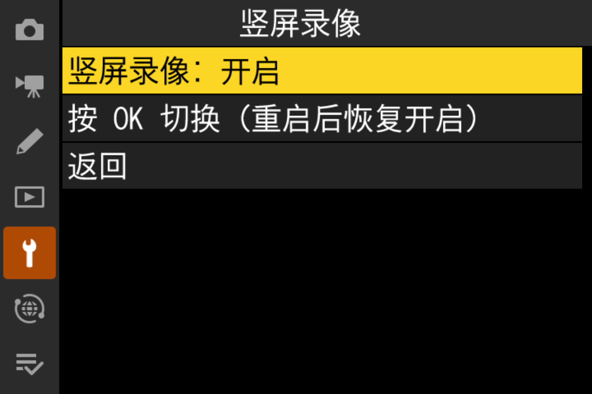
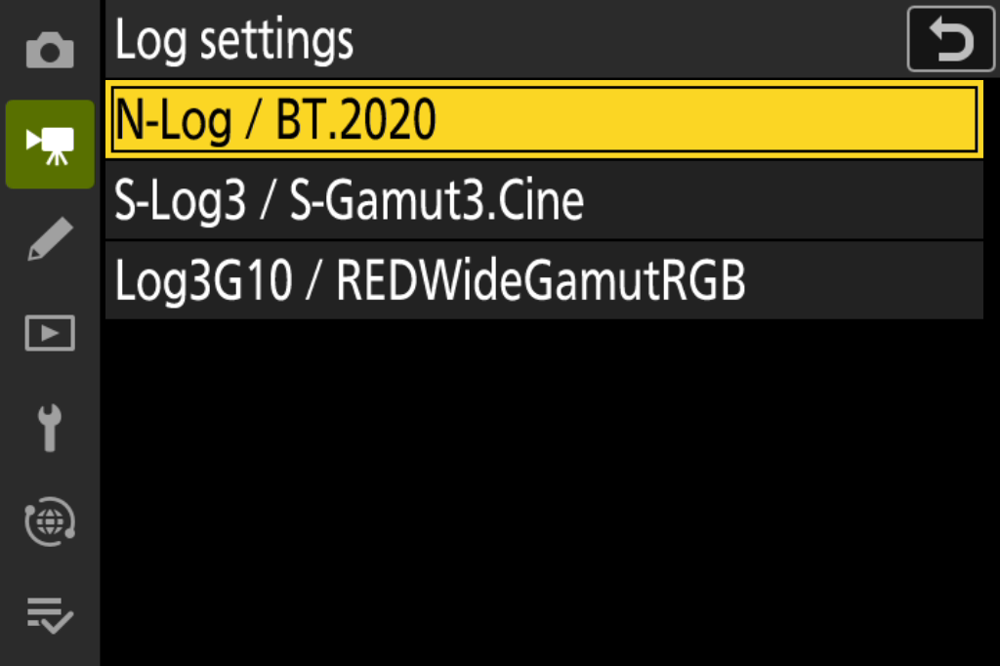

# Fenestra for Nikon Z8 (`C3.11`) 详细功能与全菜单设置手册（`V71.7-r7`）

[English](features-and-usage.md) | **简体中文** | [返回 README](../README.zh-CN.md)

本手册面向 **Nikon Z8（原厂固件 C3.11，分支 `z8-c311`）**，提供当前最新 **`V71.7-r7`**（`Z8-v71.7r7-LutPreview-362ee2a5`，内部标识 `04.06.p0`，Bootguard Build ID `0x8394568f`）的完整功能架构、原厂照片拍摄菜单 3D LUT 浏览器与 **全部 5 款内置 `.wlm` 插件** 的逐行菜单/子页/默认值参考、升级与排障指南，并保留根目录核心框架与历史归档的开发者构建说明。

---

## 1. 版本标识、四项流畅度根修与诚实验证边界

### 1.1 `V71.7-r7` 发布标识

| 项目 | 数值 |
| :--- | :--- |
| **发布包名称** | **`Z8-v71.7r7-LutPreview-362ee2a5`**（`V71.7-r7`） |
| **基准原厂固件** | Nikon Z8 **`C3.11`**（`Z_8_0311.bin`，`99,051,117` 字节） |
| **内部版本标识** | `04.06.p0` |
| **Bootguard Build ID** | `0x8394568f`（位于 `0x401FE060`） |
| **MAIN（`eg2070`）SHA-256** | `362ee2a5491859a762b35ed8459cf22c212ae5babb38915daa15e3b801533c8a`（`81,807,709 B`） |
| **XM6 Core 0 ELF0 占用** | `.text.z8fx = 156,736 / 158,336 B`，`.rodata.z8fx = 2,016 / 2,048 B` |
| **5 款内置 `.wlm` 插件** | `filmsim.wlm`（`32,540 B`）、`livephoto.wlm`（`15,860 B`）、`lut.wlm`（`15,624 B`）、`slotcard.wlm`（`56,552 B`）、`portrait.wlm`（`7,348 B`） |
| **实体相机验证状态** | **`physical_camera_verified = false`**（待真机刷写实拍复测） |

### 1.2 `V71.7-r7` 四项核心流畅度根修

针对 `V71.1–V71.6` 实体 Nikon Z8 的只读 USB 探针与实拍 Live `.MOV` 取证，本版完成四项底层根修：

1. **XM6 桥接去竞争（根除 `r6` 约 `21–22.5%` `ERR_NOT_READY` 回退）**：拆分锁前静态就绪检查与锁后邮箱空闲等待（最长 `16 ms` 排队 + `dly_tsk(0)` 交接），并将 IOMMU 映射与提交前 D-Cache 清洗提前到持锁之前，最大限度压缩 `xm6_busy` 锁持有时间。
2. **反向「Layer 0 → Live」单通道共享（EVF `1280×852` 与背屏 `1024×682` 均生效）**：开启 LUT / 图层 0 实时取景预览时，Layer 0 在 Stage 1 HDF 后、Stage 2 颗粒前按 `>= 18 ms` 节奏将已调色+HDF 的 NV12 直接推入 Live `LBUF`（`FS_TB_GRADED_READY`）；CPU0 跳过重复缩放与提交，`live_worker` 与 XM6 不再重复调色与 HDF，同时解除旧版「Live → 背屏」30 fps 封顶。
3. **528 KiB L2 常驻预烘焙 `64×64×33` YCbCr 3D LUT + 内联 NEON 拷贝 + 融合颗粒缓存清洗**：从 `photo_workspace` 已有 `stage_cpu + 0x80000` 未使用尾部切出 528 KiB 表（**零 General 堆增长**，Class `0x24` 严格保持 `0xE8C000`），采用 `2×2` Bayer 色度抖动 + 3-bit Y 线性插值（中性灰零偏色，NEON == Scalar 逐位 `0-diff`）；仅在独立 Live 运行时启用自适应 30 fps EVF 均匀节拍。
4. **快门后 45.4MP 静图顺延**：在 `live_runtime_post_roll_active()` 期间且非连拍双槽满载时，将 45.4MP 静图 `PENDING → COPY` 顺延至 post-roll 结束（硬上限 `1.65 s`），彻底消除快门后实况 `.MOV` 后半段冻结，维持流畅 `29.97 fps`。

### 1.3 诚实验证状态与仿真边界

- **不分发专有文件**：本仓库**不分发**预编译固件二进制、Nikon 密钥或提取出的 `ZF_GRAIN.BIN` / `.cube` 文件。
- **全部自动化验证回执（实跑于 `362ee2a5`）**：
  - **CEVA-XM6 `dcli.exe`**：`51/51 PASS`（`GRAIN 25/25` + `HDF 26/26`，`0-diff`）。
  - **0-Q-Spill 静态审计**：`1,114` 个链接函数，`q_spills = 0`。
  - **Host ASan + UBSan**：`lut_core` 8/8、`xm6_bridge` 9/9、`layer0` 9/9、`photo_menu` 6/6 全通过。
  - **6 套 ARM64 / Unicorn 套件**：Suite #5 FontCJK（3,755/3,755 简繁）、Suite #14 Layer0（63 项）、XM6 Bridge（124 项，0 违规调用）、Suite #4 FilmSim（70 项）、Suite #2 HangFix、5-WLM 0 缺字审计。
  - **两套整机 QEMU 验收**：`#19-r7` `14/14 PASS`（纯净 7 行 Fenestra + 5 插件 + XM6 自检/持久化/回退）与 `#20-r7` `13/13 PASS`（Row 47 流式 `.cube` LUT + Layer 0 528 KiB 预烘焙 LUT + Still + Movie `0 B` 挂起 + 重启恢复/清除），`z8_unk = 0`、`panic = 0`。
- **真机边界**：`V71.7-r7`（`362ee2a5`）标记为 **`physical_camera_verified = false`**。`z8-qemu` 仅建模 `1024×682` LCD 输出（无物理 EVF 面板）且 Wave5 同步完成，实机 EVF/背屏帧率、XM6 回退率与实拍 Live `.MOV` 帧率须在实体 Z8 上最终复测。

---

## 2. 存储卡目录布局与升级指南

### 2.1 `V71.7-r7` 存储卡完整清单

| 相对存储卡根目录路径 | 精确体积 / 格式 | 分类 | 用途与注意事项 |
| :--- | :--- | :--- | :--- |
| `Z_8_0406.bin` | 加密升级容器 | 仅升级期放置 | 仅在相机执行「设定菜单 → 固件版本」更新时放于根目录，**升级完毕请删除**。 |
| `FENESTRA/STARTUP-Z8.0` | `64 B` | 发行文件 (1/7) | Fenestra 启动与自动激活配置。 |
| `FENESTRA/filmsim.wlm` | `32,540 B` | 发行文件 (2/7) | Zf 颗粒 / 理光 HDF / XM6 DSP / 按云创 NP3 绑定插件（三语）。 |
| `FENESTRA/livephoto.wlm` | `15,860 B` | 发行文件 (3/7) | 实况照片、全双工快门声音、回放按键与调试统计插件（三语）。 |
| `FENESTRA/lut.wlm` | `15,624 B` | 发行文件 (4/7) | 实时 3D LUT 开关、清除与图层 0 调试插件（三语）。 |
| `FENESTRA/slotcard.wlm` | `56,552 B` | 发行文件 (5/7) | 双卡 C32/C64 滤镜槽插件（三语 + `FX_TIMEOUT` 修复 + 调试子页）。 |
| `FENESTRA/portrait.wlm` | `7,348 B` | 发行文件 (6/7) | 竖屏录像运行期开关与调试子页插件（三语）。 |
| `FENESTRA/ZF_GRAIN.BIN` | `27,588 B`（`ZFG1` + CRC32） | 发行文件 (7/7) | 尼康 Zf C3.01 银盐颗粒纹理表（用户自备；启用颗粒时必需）。 |
| `FENESTRA/LUTS/<分类>/*.cube` | 单文件 `<= 2 MiB` | 可选素材 | 分类 3D/1D `.cube` LUT，照片拍摄菜单第 47 项直接分页浏览（支持一级目录）。 |
| `FENESTRA/*.cube` | 单文件 `<= 2 MiB` | 可选素材 | 平铺 `.cube` LUT，在照片菜单「根目录 LUT」下显示。 |
| `FENESTRA/FXPHOTO0.CFG`, `FXPHOTO1.CFG` | `96 B`（`FXPHOTO` + CRC32） | 机内自动维护 | 双槽原子化当前 3D LUT 路径持久化（`FXPHOTO.TMP` 临时中转）。 |
| `FENESTRA/FXLUT0.CFG`, `FXLUT1.CFG` | `32 B`（`ZLT1` + CRC32） | 机内自动维护 | `lut.wlm` 开关双槽持久化。 |
| `FENESTRA/FLMSIM0.CFG`, `FLMSIM1.CFG` | `64 B`（`ZFS1` + CRC32） | 机内自动维护 | 全局胶片模拟 / HDF / XM6 / 实时预览双槽配置。 |
| `FENESTRA/FLMREC0.CFG`, `FLMREC1.CFG` | 95 槽 + CRC32 | 机内自动维护 | 按云创 NP3 配方独立绑定双槽表。 |
| `FENESTRA/SLTCARD0.CFG`, `SLTCARD1.CFG` | `32 B`（`ZSC1` + CRC32） | 机内自动维护 | C64 存储卡模式（`自动 / A / B`）双槽配置。 |
| `FENESTRA/SCSEL0.CFG`, `SCSEL1.CFG` | `64 B` + CRC32 | 机内自动维护 | C64 槽位选择防抖持久化（`Fn` 拨盘）。 |
| `FENESTRA/SC*.REC` | 原子化代数存档 | 机内自动维护 | `C10–C64` 优化校准卡片存档（含 `+0x39C` `'Z8FX'` 绑定区）。 |
| `FENESTRA/live-z8.0`, `live-z8.1` | `64 B`（`FLP1` + CRC32） | 机内自动维护 | 实况照片双槽配置。 |
| `FENESTRA/XM6_DIAG.LOG`, `LIVELOG.BIN` | 按需导出日志 | 机内按需写入 | 在 `filmsim.wlm` / `livephoto.wlm` 调试子页触发时导出。 |
| `DCIM/<目录>/DSC_xxxx.NEF` / `.JPG` | 原厂静态照 | 相机写入 | **14-bit `.NEF` 严格 `0-diff` 不改动。** |
| `LIVE/<目录>/DSC_xxxx.MOV` | `1280×852` HEVC + 48kHz 24-bit 立体声 | 相机写入 | 配对约 3 秒有声实况短片。 |
| `LIVEDATA/<目录>/DSC_xxxx.{MAN,LVP}` | 机内专用 | 相机写入 | 机内配对清单与预览索引。 |

### 2.2 安全升级对照

- **从 `V71.7-r6` 升级至 `V71.7-r7`**：卡内 `FENESTRA/` 全部 7 个文件与 `r6` 逐字节一致，**仅需刷入 `Z_8_0406.bin`** 后删除。
- **从 `V71.7-r5` 或更早版本升级**：完整覆盖 `FENESTRA/` 全部 7 个发行文件并刷入 `Z_8_0406.bin`，保留 `DCIM/`、`LIVE/`、`LIVEDATA/`、`LUTS/` 及所有 `*.CFG`、`SC*.REC`、`live-z8.*`。

---

## 3. 纯净 7 行 `Fenestra` 主菜单、`插件管理` 与三语字库（`FontCJK-ZhUI`）

| 纯净 7 行 `Fenestra` 主菜单 | `插件管理`（5 款内置插件） | 异常关机保护 |
| :---: | :---: | :---: |
|  |  |  |

- **纯净 7 行 `Fenestra` 主菜单**：`V71.7` 起将实况照片控制项整体迁入 `插件管理 → 实况照片`（`livephoto.wlm`），使 `设定菜单 → Fenestra` 恢复简洁的 7 行主控面板（含 `已加载插件`、`异常关机保护` 等）。
- **三语字库与热切换**：`FontCJK-ZhUI` 仅在中文界面下为原厂 `Font[18]` 挂载 `CJK_EXT_1` + `CJK_EXT_2`（3,755 简繁汉字，5 款插件全覆盖 `0` 缺字），英文与原厂词条 100% 保持原样；全部 5 款插件每秒轮询 `slots.state` op `15`（`SLOTS_LANG_GET`），在 `设定菜单 → 语言` 切换 `简体中文 (8)` / `繁體中文 (9)` / `English` 后无需重启实时生效。

---

## 4. 实时 3D LUT 预览（原厂照片拍摄菜单第 47 项 + `lut.wlm`）

| 照片拍摄菜单第 47 项（`选择 LUT`） | 分类浏览（`FENESTRA/LUTS/`） | `.cube` 文件列表（20 项/页） |
| :---: | :---: | :---: |
|  |  |  |
| **已载入状态（`已载入`）** | **实时取景 3D LUT 生效** | **`lut.wlm` 主菜单** |
|  |  |  |

### 4.1 原厂照片拍摄菜单第 47 项（`选择 LUT` / `Select LUT`）

- **菜单入口**：照片拍摄菜单 **第 47 项**（`0x2DE7`），支持简/繁/英/日四语（`选择 LUT` / `選擇 LUT` / `Select LUT` / `LUT 選択`）。受 `lut.wlm` 动态门控：若停用 `lut.wlm` 会显示 `选择 LUT (未启用)`，关闭 `3D LUT 开关` 会显示 `选择 LUT (已关闭)`。
- **23 行原生分页浏览器（`Page 0x5D6`）**：
  - **第 0 行**：根目录显示 `无LUT`（清除当前 LUT），进入分类目录后显示 `返回上一级`。
  - **第 1–20 行**：每页显示最多 20 个分类目录或 `.cube` 文件（按名称排序）；若 `FENESTRA/` 根目录放有平铺 `.cube` 文件，会出现 `根目录 LUT` 入口。
  - **第 21 / 22 行**：`上一页` / `下一页` 分页按钮。
  - **标题状态栏**：实时显示工作线程阶段（`无LUT`、`等待载入`、`正在读取`、`正在处理 <0..100%>`、`已载入`、`找不到 LUT 文件`、`LUT 文件无效`、`内存不足`、`LUT 插件未启用`、`3D LUT 已关闭`）。
- **内置 10 组中文分类译名（`FENESTRA/LUTS/<目录>/`）**：
  - `01-Fuji-Film`（`FUJI 色调`）、`02-Kodak-Negative`（`Kodak 负片`）、`03-Classic-Negative`（`传统负片`）、`04-Color-Slide`（`彩色反转片`）、`05-Black-and-White`（`黑白片`）、`06-Instant-Polaroid`（`拍立得即显`）、`07-Cinema-Print`（`电影色调`）、`08-Camera-Style`（`相机直出与机内风格`）、`09-Portrait-Daily`（`人像与日常拍摄`）、`10-Creative-Vintage`（`创意色调`）——同时支持任意自定义 ASCII 分类文件夹名。
- **直接流式读取 `.cube`**：直接支持标准 `.cube` 文件（单文件 `<= 2 MiB`），3D LUT 由 `V71.7-r7` **528 KiB L2 预烘焙 `64×64×33` YCbCr 表** 高速渲染，1D 可分离 LUT 自动走 `1D-XM6`；选择结果写入 `FXPHOTO0/1.CFG` 冷重启自动恢复。

### 4.2 `lut.wlm` 全部 13 项菜单与调试子页对照表

| # | 所属层级 | 简体中文 | 繁體中文 | English | 类型 / 可选值 | 默认值 | 功能说明 |
| :-: | :--- | :--- | :--- | :--- | :--- | :---: | :--- |
| 1 | 根页面 | `3D LUT 调色` | `3D LUT 調色` | `3D LUT` | 根页面 | — | `插件管理` 入口页。 |
| 2 | 主页 | `3D LUT 开关` | `3D LUT 開關` | `3D LUT Enable` | 开关（`开启` / `关闭`） | **`开启`** | 3D LUT 总开关（持久化至 `FXLUT0/1.CFG`）；关闭后照片菜单第 47 项同步挂起。 |
| 3 | 主页 | `当前 LUT` | `目前 LUT` | `Active LUT` | 只读显示 | `无` | 显示当前已载入的 `.cube` 文件名，或提示 `无 LUT (在照片菜单选择)`。 |
| 4 | 主页 | `取景实时预览` | `取景即時預覽` | `Live View Preview` | 开关（`开启` / `关闭`） | **`开启`** | 控制 EVF 与背屏 Layer 0 实时取景 LUT 预览。 |
| 5 | 主页 | `照片 LUT` | `照片 LUT` | `Still JPEG LUT` | 开关（`开启` / `关闭`） | **`开启`** | 控制 45.4MP 静态 JPEG 是否应用 Stage 0 LUT（14-bit `.NEF` 始终 0 改动）。 |
| 6 | 主页 | `实况照片 LUT` | `實況照片 LUT` | `Live Photo LUT` | 开关（`开启` / `关闭`） | **`开启`** | 控制 `1280×852` HEVC 实况短片是否应用 Stage 0 LUT。 |
| 7 | 主页 | `清除当前 LUT` | `清除目前 LUT` | `Clear Active LUT` | 操作（`按此清除`） | — | 立即卸载当前 LUT 并清除 `FXPHOTO0/1.CFG` 记录。 |
| 8 | 主页 → 子页 | `调试设置` | `調試設定` | `Debug Settings` | 子页面 | — | 进入 5 行图层 0 与 LUT 运行状态调试子页。 |
| 9 | 调试子页 | `管线与加速` | `管線與加速` | `Pipeline & Accel` | 只读遥测 | — | `<OFF\|IDLE\|1D-XM6\|3D-NEON\|3D-CPU> C<核数> Gen:<代数>`。 |
| 10 | 调试子页 | `图层 0 预览` | `圖層 0 預覽` | `Layer 0 Preview` | 只读遥测 | — | `WS:<MiB>M <fps>fps Sub:<提交数> REJ:<拒绝数>`。 |
| 11 | 调试子页 | `健康与隔离` | `健康與隔離` | `Health & Drive` | 只读遥测 | — | `NEON:<0\|1> Q:<隔离标志> Pool:<池状态> [A\|B]`。 |
| 12 | 调试子页 | `看门狗状态` | `看門狗狀態` | `Watchdog` | 只读遥测 | — | `WD:<轮询数> Phase:<阶段> Err:<错误码>`。 |
| 13 | 调试子页 | `重置预览工作区` | `重設預覽工作區` | `Reset Preview Pool` | 操作（`按此重置`） | — | 触发 `LUT_OP_RESET_PREVIEW` 重置图层 0 工作区（已隔离态不可重置）。 |

---

## 5. 胶片模拟、理光光学 HDF 与 EXPEED 7 CEVA-XM6 硬件 DSP（`filmsim.wlm`）

| `filmsim.wlm` 主菜单 | `filmsim.wlm` 调试与 XM6 子页 | EXPEED 7 CEVA-XM6 自检读数 |
| :---: | :---: | :---: |
|  |  |  |

### 5.1 `filmsim.wlm` 全部 16 项菜单与调试子页对照表

| # | 所属层级 | 简体中文 | 繁體中文 | English | 类型 / 可选值 | 默认值 | 功能说明 |
| :-: | :--- | :--- | :--- | :--- | :--- | :---: | :--- |
| 1 | 根页面 | `胶片模拟 / HDF` | `膠片模擬 / HDF` | `Film Simulation` | 根页面 | — | `插件管理` 入口页。 |
| 2 | 主页 | `生效模式` | `生效模式` | `Apply Mode` | `全局生效` / `按优化校准` | **`全局生效`** | `全局生效` 作用于所有优化校准；`按优化校准`（Per-NP3）仅对已绑定槽位生效，未绑定槽位自动 `0 B` 休眠。 |
| 3 | 主页 | `颗粒强度` | `顆粒強度` | `Grain Intensity` | `关闭`、`1` .. `6` | **`关闭`** | 尼康 Zf C3.01 银盐颗粒强度（6 档强度 × 3 档大小 = 18 档，需 `ZF_GRAIN.BIN`）。 |
| 4 | 主页 | `颗粒大小` | `顆粒大小` | `Grain Size` | `1 (小)` / `2 (中)` / `3 (大)` | **`2 (中)`** | 颗粒团簇物理尺寸（`1` ≈ ISO 100–200，`2` ≈ ISO 400，`3` ≈ 迫冲 ISO 1600–3200）。 |
| 5 | 主页 | `颗粒质感` | `顆粒質感` | `Grain Texture` | `柔和 (Zf)` / `清晰` | **`清晰`** | **`清晰`（默认）**：仅柔化颗粒增量，100% 保留 45.4MP 锐度；`柔和 (Zf)` 逐位复刻 Zf `BlurLineRing`。 |
| 6 | 主页 | `高光柔焦 HDF` | `高光柔焦 HDF` | `HDF Level` | `关闭` / `弱 (1/8)` / `中 (1/4)` / `强 (1/2)` | **`关闭`** | 线性光多尺度高光扩散滤镜（独立正交，可单开或与 3D LUT、颗粒自由叠加）。 |
| 7 | 主页 | `实况照片联动` | `實況照片聯動` | `Live Photo Link` | 开关（`关闭` / `开启`） | **`关闭`** | 实时将当前颗粒与 HDF 配方同步至 `1280×852` HEVC 实况短片。 |
| 8 | 主页 | `取景实时预览` | `取景即時預覽` | `WYSIWYG Preview` | 开关（`关闭` / `开启`） | **`关闭`** | 通过 Layer 0 在 EVF 与背屏实时预览 HDF 与颗粒效果。 |
| 9 | 主页 | `绑定当前配方` | `關聯目前配方` | `Bind Active NP3` | 操作（`<优化校准> [已绑定\|未绑定]`） | — | 将当前颗粒/HDF/实况参数绑定到当前选中的优化校准（写入 `FLMREC0/1.CFG` 与 `SC*.REC +0x39C`）。 |
| 10 | 主页 | `清除当前配方` | `清除目前配方` | `Clear Active NP3` | 操作（`已绑定:<n>`） | — | 解除当前优化校准槽位的独立绑定。 |
| 11 | 主页 → 子页 | `调试设置` | `調試設定` | `Debug Settings` | 子页面 | — | 进入 5 行 XM6 硬件 DSP 与诊断子页。 |
| 12 | 调试子页 | `XM6 DSP 模式` | `XM6 DSP 模式` | `XM6 DSP Mode` | `自动` / `仅 CPU` | **`自动`** | `自动` 优先调用 EXPEED 7 CEVA-XM6 硬件 DSP（异常自动回退 NEON）；`仅 CPU` 强制走 ARM NEON。 |
| 13 | 调试子页 | `运行 XM6 自检` | `執行 XM6 自檢` | `Run XM6 Self-Test` | 操作（`按此运行自检`） | — | 运行 4 场景 `0-diff` 硬件校验（Grain Exact/Sharp + HDF Still/Live），显示 `XM6自检通过 0错 G/H/S` 耗时并导出 `FENESTRA/XM6_DIAG.LOG`。 |
| 14 | 调试子页 | `重置 XM6 熔断器` | `重設 XM6 熔斷器` | `Reset XM6 Breaker` | 操作（`正常` / `已熔断 E:<n>`） | — | 手动清除 XM6 安全熔断状态以恢复硬件加速。 |
| 15 | 调试子页 | `硬件与运行状态` | `硬體與運行狀態` | `Hardware & Runtime` | 只读遥测 | — | `EL1:<ON\|DM\|IN\|E#> S:<静图> L:<实况> XM6:<OK 成功/回退\|CPU\|NO\|TR\|LF> [A\|B]`。 |
| 16 | 调试子页 | `恢复默认设置` | `還原預設設定` | `Reset Defaults` | 弹窗确认 | — | 一键还原全局默认设置并落盘至 `FLMSIM0/1.CFG`。 |

---

## 6. 丝滑 30fps 全双工实况照片（`livephoto.wlm`）与 `r7` 流畅度架构

| `livephoto.wlm` 主菜单 | LCD 取景 `◎LIVE` | 单张回放 `◎LIVE` | 按 `REC` 原厂播放器 |
| :---: | :---: | :---: | :---: |
|  |  |  |  |

### 6.1 `livephoto.wlm` 全部 11 项菜单与调试子页对照表

| # | 所属层级 | 简体中文 | 繁體中文 | English | 类型 / 可选值 | 默认值 | 功能说明 |
| :-: | :--- | :--- | :--- | :--- | :--- | :---: | :--- |
| 1 | 根页面 | `实况照片` | `實況照片` | `Live Photo` | 根页面 | — | `插件管理` 入口页（双槽持久化至 `FENESTRA/live-z8.0` / `live-z8.1`）。 |
| 2 | 主页 | `实况照片` | `實況照片` | `Live Photo` | `关闭` / `开启` | **`关闭`** | 实况照片总开关（`1280×852` HEVC 约 3 秒循环录制）。 |
| 3 | 主页 | `快门声音` | `快門聲音` | `Shutter Sound` | `开启` / `关闭` | **`开启`** | 全双工 48 kHz 24-bit 立体声 PCM + 11 快门钩子（**`0.0 ms` 音频断层**），严格遵循原厂静音拍摄模式。 |
| 4 | 主页 | `回放按键` | `回放按鍵` | `Playback Key` | `REC 键` / `关闭` | **`REC 键`** | 单张回放 `◎LIVE` 照片时按 `REC` 调起尼康原厂有声视频播放器，播完精准退回原照片（支持双卡 RAW+JPEG）。 |
| 5 | 主页 | `当前状态` | `目前狀態` | `Status` | 只读状态 | `关闭` | `关闭` / `准备中` / `短片段` / `就绪` / `保存中` / `不可用` / `卡错误`。 |
| 6 | 主页 → 子页 | `调试设置` | `調試設定` | `Debug Settings` | 子页面 | — | 进入 5 行 Wave5、音频、回放与日志诊断子页。 |
| 7 | 调试子页 | `录制统计` | `錄製統計` | `Capture Stats` | 只读遥测 | — | `Tx:<成功>/<错误> Enc:<编码帧> Drop:<丢帧>`。 |
| 8 | 调试子页 | `Wave5 与音频` | `Wave5 與音訊` | `Wave5 & Audio` | 只读遥测 | — | `W5:<ACT\|PARK\|IDLE\|ERR> Aud:<阶段>/<音轨>`。 |
| 9 | 调试子页 | `回放与双卡` | `回放與雙卡` | `Playback & Drive` | 只读遥测 | — | `REC:<触发数> PB:<帧数>/<错误> [A\|B]`。 |
| 10 | 调试子页 | `关机保护与日志` | `關機保護與記錄` | `Flag & Log` | 只读遥测 | — | `Park:<驻停>/<恢复> Log:<保存> [E:<错误>]`。 |
| 11 | 调试子页 | `导出诊断日志` | `匯出檢測記錄` | `Export LIVELOG.BIN` | 操作（`按此导出`） | — | 将内存环形诊断日志刷写到 `FENESTRA/LIVELOG.BIN`。 |

---

## 7. 双卡 `C64 滤镜槽` 插件（`slotcard.wlm`）与云创原生图标

| C64 云创原生图标（`Fn` 拨盘） | C64 云创原生图标（`i` 键菜单） | `C64 滤镜槽` 插件界面 |
| :---: | :---: | :---: |
|  |  |  |

`slotcard.wlm` 将 Z8 照片与视频自定义优化校准槽位扩容至 `C-1..C-32` 或 `C-1..C-64`，配备全机 7+ 处实时合成 **`[FC]C-10..C-64`** 云创原生图标、`Fn` + 指令拨盘切槽（`SCSEL0/1.CFG`）以及 `34.46×` `FX_TIMEOUT (0x7)` 防超时加固。

### `slotcard.wlm` 全部 7 项菜单与调试子页对照表

| # | 所属层级 | 简体中文 | 繁體中文 | English | 类型 / 可选值 | 默认值 | 功能说明 |
| :-: | :--- | :--- | :--- | :--- | :--- | :---: | :--- |
| 1 | 根页面 | `C64 滤镜槽`（或 `C32`） | `C64 濾鏡槽` | `C64 Filter Slots` | 根页面 | — | `插件管理` 入口页。 |
| 2 | 主页 | `滤镜槽容量` | `濾鏡槽容量` | `Slot Limit` | `C64 (64 槽)` / `C32 (32 槽)`（`(重启生效)`） | **`C64`** | 切换扩展优化校准槽位上限，下次重启生效。 |
| 3 | 主页 | `存储卡` | `記憶卡` | `Storage Card` | `自动` / `CFx (A)` / `SD (B)`（`(重启生效)`） | **`自动`** | 双槽持久化至 `SLTCARD0/1.CFG`。严格 `CFx (A)` / `SD (B)` 缺卡或无 `FENESTRA/` 时安全停留在原厂 `C1–C9`，绝不误写另一张卡。 |
| 4 | 主页 → 子页 | `调试设置` | `調試設定` | `Debug Settings` | 子页面 | — | 进入 3 行插槽状态与引导诊断子页。 |
| 5 | 调试子页 | `插槽状态` | `插槽狀態` | `Slot State` | 只读遥测 | — | `状态 运行中 已用 <n> 异常 <n> [A\|B]` 或缺卡/换卡提示。 |
| 6 | 调试子页 | `存储日志` | `存儲記錄` | `Store Journal` | 只读遥测 | — | `存档代 <gen> 提交 <n>`（当前 `SC<gen>.REC` 代号与提交次数）。 |
| 7 | 调试子页 | `卡槽引导` | `卡槽引導` | `Boot Card Latch` | 只读遥测 | — | `CSL1:<A\|B\|0\|-> Miss:<原因> SEQ:<选槽序号>`。 |

---

## 8. `竖屏录像` 运行期开关插件（`portrait.wlm`）与竖屏 HUD

| `竖屏录像` 插件 | 竖屏视频录制 HUD（`90°`） | 视频 `Log settings` 菜单 |
| :---: | :---: | :---: |
|  |  |  |

| # | 所属层级 | 简体中文 | 繁體中文 | English | 类型 / 可选值 | 默认值 | 功能说明 |
| :-: | :--- | :--- | :--- | :--- | :--- | :---: | :--- |
| 1 | 根页面 | `竖屏录像` | `直拍錄影` | `Portrait Video` | 根页面 | — | `插件管理` 入口页。 |
| 2 | 主页 | `竖屏录像` | `直拍錄影` | `Portrait Video` | 操作（`开启` / `关闭` / `不可用`） | **`开启`** *(插件启用时)* | 按 `OK` 运行期即时开关 8-hook `PortraitPB`（`tkhd` + `NCTG 0x0018` 正立元数据、竖屏 OSD 与直方图）。 |
| 3 | 主页 → 子页 | `调试设置` | `調試設定` | `Debug Settings` | 子页面 | — | 进入 2 行运行状态诊断子页。 |
| 4 | 调试子页 | `运行状态` | `運行狀態` | `Runtime Status` | 只读遥测 | — | `EL1 Gate:<0\|1\|ERR> slots.state:<OK\|ERR>`（按 `OK` 刷新）。 |
| 5 | 调试子页 | `说明` | `說明` | `Note` | 提示行 | — | 提示运行期切换不跨重启持久化；永久关闭请到 `Fenestra → 已加载插件` 禁用 `portrait.wlm`。 |

---

## 9. 故障排查速查表

| 现象 | 常见原因 | 解决方法 |
| :--- | :--- | :--- |
| 照片菜单第 47 项显示 `选择 LUT (未启用)` 或 `(已关闭)` | `lut.wlm` 被禁用，或 `3D LUT 开关` 为关闭 | 在 `Fenestra → 已加载插件` 启用 `lut.wlm`（重启），并在 `插件管理 → 3D LUT 调色` 打开 `3D LUT 开关`。 |
| 照片菜单看不到放进去的 `.cube` 文件 | 文件超过 `2 MiB`、目录层级超过 1 级或含非 ASCII 文件名 | 使用 ASCII 文件名且 `<= 2 MiB`，放于 `FENESTRA/*.cube` 或 `FENESTRA/LUTS/<分类>/*.cube`。 |
| `filmsim.wlm` 显示 `XM6:TR` 或 `XM6:NO` | XM6 熔断器触发，或当前运行于无 XM6 硅片的 QEMU | 在 `调试设置` 执行 `重置 XM6 熔断器` 或 `运行 XM6 自检`；熔断期间 ARM NEON 回退会自动保持正常出图。 |
| 颗粒未生效 | 缺少 `FENESTRA/ZF_GRAIN.BIN`，或 `生效模式 = 按优化校准` 且当前档位未绑定 | 核对卡上 `27,588 B` `ZF_GRAIN.BIN`（`ZFG1`+CRC32）；切换为 `全局生效` 或点击 `绑定当前配方`。 |
| `C64 滤镜槽` 提示缺卡或 `仅 C1-C9` | 严格模式指定的 A/B 卡未插或缺少 `FENESTRA/` 目录 | 插入目标卡并建立 `FENESTRA/`，或将 `存储卡` 切回 `自动` 后重启。 |
| `Disabled due to abnormal shutdown` | 上次激活期发生异常断电或崩溃 | 确认稳定后进入 `Fenestra → 异常关机保护` 清除异常标志并重新激活。 |

---

## 10. 开发者构建、历史归档与清单自检

```sh
# 1. 编译独立 .wlm 插件（无需原厂固件）
python host/build_sdk_module.py examples/hello/module.c \
  --id hello --target z8-c311 --output-dir build/hello-z8-local
python host/build_sdk_module.py modules/demo/sdk.c \
  --id demo --target z8-c311 --output-dir build/demo-z8-local

# 2. 编译 QEMU 专用核心镜像（输入 81,807,709 B 原厂 C3.11 MAIN）
python host/build_z8_core.py \
  --firmware /path/to/z8-c311-original-main.bin \
  --output-dir build/z8-core-local

# 3. 从官方原厂 Z_8_0311.bin 一键重建 v36 基线（Clang 18 + Clang/LLVM 21）
python -m pip install -r research/z8-live/from-stock/requirements.txt
python -B research/z8-live/from-stock/build.py \
  --stock /path/to/Z_8_0311.bin \
  --qemu-root /path/to/z8-qemu \
  --output-dir /path/to/v36-rebuilt

# 4. 提交前清单自检
python -B verify_source.py
```

- 延伸参考：[from-stock/README.md](../research/z8-live/from-stock/README.md) · [RELEASE-v62.md](../research/z8-live/build-tools/livediag/feat-onemov/RELEASE-v62.md) · [C64LABEL-RESULT.md](../research/z8-live/build-tools/livediag/feat-c64label/C64LABEL-RESULT.md) · [debugging.md](debugging.md) · [PORT-STATUS.md](../port-z8/PORT-STATUS.md)。
- **许可协议**：[CC BY-NC-SA 4.0](../LICENSE) + [商业摄影例外许可](../EXCEPTIONS.md) + [Z8 移植适用范围说明](../LICENSE-Z8.md)。
